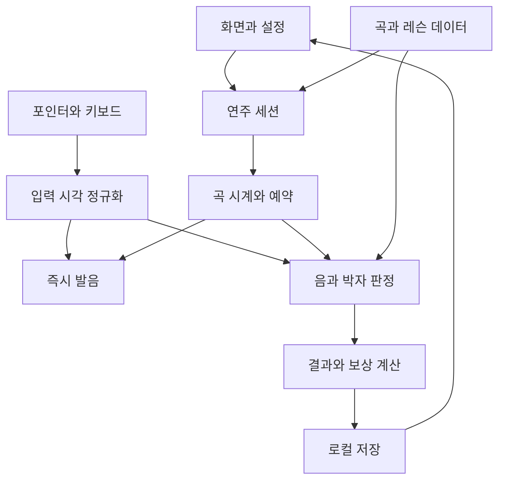
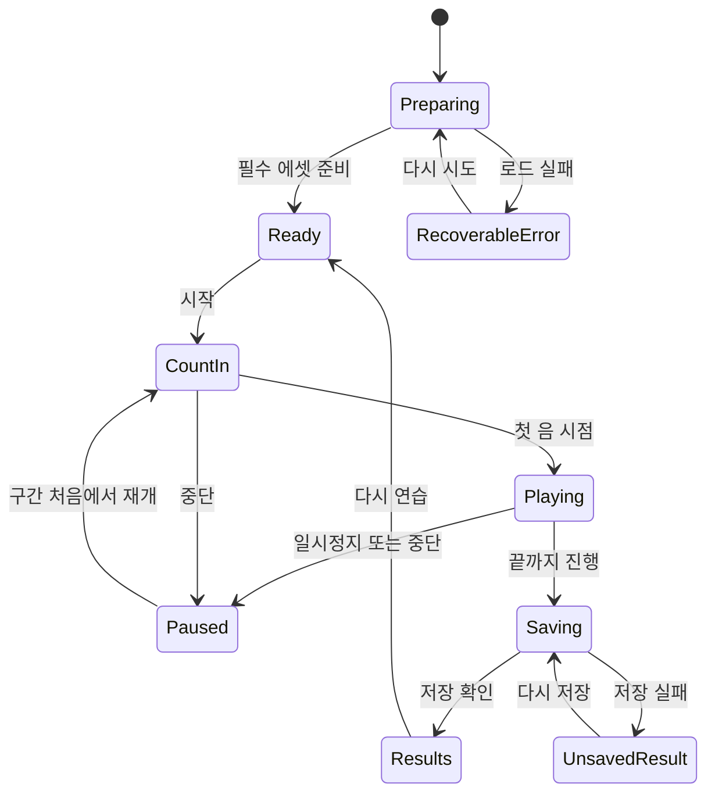

# 21키 칼림바 모바일 연주 게임 상세 설계서

> 가칭: **고양이의 칼림바 정원** · 문서 버전 **1.0** · 작성일 **2026-11-10 / Asia·Seoul**
>
> 문서 성격: 초기 구상안을 구현 가능한 제품·학습·기술 명세로 구체화한 **검토용 기준안**. 사용자에게 확정받지 않은 이름, 조율 프리셋, 수치, 콘텐츠, 기술 선택은 본 문서가 제안하는 기본값이다. 이 문서 작성은 앱 구현·GitHub 반영·운영 배포 완료를 의미하지 않는다.

## 목차

1. [문서 사용법과 근거](#section-01)
2. [제품 목표와 게임의 중심 경험](#section-02)
3. [MVP 범위와 요구사항 추적표](#section-03)
4. [음악 기준과 21키 배열](#section-04)
5. [모바일 배치와 입력 영역의 결정 규칙](#section-05)
6. [시각 디자인과 에셋 제작 명세](#section-06)
7. [학습 경험의 원칙](#section-07)
8. [초급 레슨 12단계](#section-08)
9. [원작 연습곡 5개: 전체 이벤트 명세](#section-09)
10. [콘텐츠 산술 검증표](#section-10)
11. [화면별 행동·상태 설계](#section-11)
12. [실패 회복과 보상](#section-12)
13. [입력·오디오·판정의 단일 상수표](#section-13)
14. [터치 입력 계약](#section-14)
15. [오디오 엔진](#section-15)
16. [터치 시각을 오디오 시각으로 변환](#section-16)
17. [기다림 연습의 판정](#section-17)
18. [곡 도전의 매칭 알고리즘](#section-18)
19. [점수·피드백 계약](#section-19)
20. [데이터 계약](#section-20)
21. [IndexedDB 저장·복구](#section-21)
22. [필수 판정 테스트 벡터](#section-22)
23. [오디오·입력·저장 공식 참고 자료](#section-23)
24. [레슨·도움·보상 데이터의 세부 계약](#section-24)
25. [애플리케이션 구조와 책임 분리](#section-25)
26. [상태 전환과 중단·복귀 정책](#section-26)
27. [접근성·안전한 학습 경험·오류 문구](#section-27)
28. [성능·음질·호환성 검증 목표](#section-28)
29. [단계별 개발 계획과 통과 조건](#section-29)
30. [테스트 시나리오와 출시 수용 기준](#section-30)
31. [Vercel 배포와 운영 준비 설계](#section-31)
32. [개발 작업 지시서 템플릿](#section-32)
33. [검토 항목과 변경 관리](#section-33)
34. [출처와 검증 범위](#section-34)

<a id="section-01"></a>

## 01. 문서 사용법과 근거

### 출발점

| 구분 | 내용 |
|---|---|
| 원문 | [21키 칼림바 모바일 연주 게임 — 초기 구상](https://app.notion.com/p/4141a103f482814db52be7611ab97d84) |
| 원문 확인 | 2026-11-10에 현재 본문을 다시 읽고 작성. 원문 최종 수정 시각: 2026-11-10T01:15:30.994Z |
| 관련 저장소 | [kimyounggaur/Kalimba_21_key_Game](https://github.com/kimyounggaur/Kalimba_21_key_Game) |
| 시각 참고 | [사용자 제공 play-21.png](https://chatgpt.com/library?file_id=libfile_28f1855fac508191868a9cb59b9e2e9b&account_id=personal) |
| 원본 이미지 확인값 | 1587×2048px, RGBA, 732,903바이트. 그림에 음 이름이 없으므로 이미지 자체만으로 조율을 확정하지 않음 |
| 확정된 사용자 요청 | 21키 칼림바를 연주할 수 있는 모바일 웹앱 게임, 현재 단계의 산출물은 구체적·단계적인 Markdown 설계 문서 |
| 문서의 주요 제안 | 연주·학습 중심, 고양이 정원 보상, F3–E6 C장조 프리셋, 브라우저 내 저장, 원작 연습곡 5개 |

### 읽는 순서

1. 기획 담당자는 제품 목표·범위와 화면·학습 설계를 먼저 읽는다.
2. 개발자는 21키 기준표 → 화면 배치 → 입력/오디오 → 판정 → 데이터 계약 순으로 읽는다.
3. 콘텐츠 담당자는 곡 표기 규칙·5개 원작 연습곡·레슨별 완료 기준을 확인한다.
4. 검수자는 요구사항 ID와 테스트 ID를 개발 단계별 완료 기준에 연결한다.
5. 수치 조정 시 판정 규칙 버전과 콘텐츠 버전을 갱신한다. 문서 안의 한 표만 바꾸고 구현·테스트를 방치하지 않는다.

### 표현의 의미

- **필수**: 이 설계로 MVP를 구현할 때 충족해야 하는 기준.
- **기본값**: 구현을 시작하기 위한 제안값. 실제 기기·사용자 검증 후 변경할 수 있다.
- **후속**: MVP에 포함하지 않는 확장 후보.
- **검증 목표**: 아직 측정하지 않은 품질 목표. 달성했다고 보고하지 않는다.
- **보류**: 사용자 선택이나 에셋 확보가 필요하지만 독립적인 기초 구현은 진행할 수 있는 항목.

<a id="section-02"></a>

## 02. 제품 목표와 게임의 중심 경험

### 한 문장 정의

**고양이 무늬의 21키 칼림바를 직접 두드리며 짧은 멜로디를 익히고, 한 곡을 완성하면 작은 정원이 자라는 모바일 연주 학습 게임.**

### 해결할 문제

| 문제 | 설계 대응 | 성공 확인 방법 |
|---|---|---|
| 키마다 어느 음인지 찾기 어렵다 | 실제 배열을 유지한 빛·숫자·계이름 안내 | 처음 보는 3개 음을 기다림 연습에서 구분 |
| 음 찾기와 박자를 동시에 요구하면 부담이 크다 | 듣기 → 기다림 → 느린 박자 → 독립 연주 | 기다림 연습과 박자 점수를 별도로 저장 |
| 휴대폰에서 21개 키가 너무 좁다 | 물리키 범위 기반 확대와 고정 보조패드 | 360px에서도 모든 음에 도달 가능한 대체 조작 |
| 실패 후 곡 전체를 다시 해야 한다 | 구간 단위 반복과 느린 재연습 | 결과에서 2마디를 골라 바로 진입 |
| 게임은 끝냈지만 혼자 연주하지 못한다 | 다음 음·현재 음 안내를 단계적으로 줄임 | 보조 사용 여부가 기록된 완주 결과 |

### 사용자 가정

- 우선 사용자: 칼림바·숫자악보를 처음 접하는 학습자, 취미 연주자, 음악 수업 참여자. 특정 연령으로 UI를 고정하지 않는다.
- 수업 상황: 교사가 시범을 보이고 학생이 각자 휴대폰·태블릿으로 짧게 연습한다.
- 개인 상황: 로그인 없이 2~5분 동안 연주하고 이전 진도를 이어간다.
- 실제 악기로의 전이는 키 위치와 음 관계를 익히는 데 초점을 둔다. 터치 화면은 엄지손톱 튕기기와 실제 촉각을 재현하지 못한다.

### 첫 3분의 목표 시나리오

| 시점(가이드) | 화면/행동 | 의도 |
|---|---|---|
| 0~15초 | 시작 화면 → ‘소리 켜고 시작’ → 시험 음 1회 | 소리가 실제로 나오는지 확인 |
| 15~45초 | 세 키를 눌러보기. 누른 음만 표시 | 조작 학습 |
| 45~90초 | 2마디 듣기 → 올바른 음까지 기다리는 연습 | 실패 부담 없이 첫 멜로디 |
| 90~150초 | 같은 구간을 느린 박자에 맞춰 연주 | 리듬 연결 |
| 150~180초 | 결과와 첫 과제 완료 표시 → 자유 연주 또는 다음 레슨 | 명확한 성취와 선택권 |

이는 UX 검증 시나리오이며 실제 사용 시간을 제한하지 않는다. 긴 온보딩·회원가입·강제 튜토리얼 완료는 두지 않는다.

<a id="section-03"></a>

## 03. MVP 범위와 요구사항 추적표

### 범위

| 단계 | 포함 |
|---|---|
| MVP 필수 | 21키 자유 연주, 2음 화음, 기다림 연습, 시범 재생, 곡 도전, 속도 선택, 구간 반복, 숫자/계이름/영문 표시, 5곡, 입문 레슨, 로컬 저장, 작은 보상 |
| MVP 품질 | 소리 시작/중단 복구, 화면 회전·백그라운드 중단 처리, 세로 대체 조작, 키보드·스크린리더 기본 접근, 저장 실패 안내 |
| 후속 1 | 교사용 곡 편집, 연주 이벤트 녹음·재생, 데이터 백업/복원, 설치형 PWA·오프라인 곡팩 |
| 후속 2 | 오선악보, 실제 악기 마이크 인식, 글리산도, 사용자 조율, 더 많은 곡·스킨 |
| 별도 검토 | 로그인·동기화·온라인 순위·멀티플레이·결제·대형 탐험 월드 |

### 요구사항 ID

| ID | 필수 동작 | 완료 증거 |
|---|---|---|
| MUS-01 | 21개 물리키 ID와 음·MIDI의 일대일 매핑 | 자동 매핑 검사 + 실제 소리 확인 |
| MUS-02 | 한 번 누르면 한 번 발음, 놓아도 자연 감쇠 | 1초 홀드에서 noteOn 1회 |
| MUS-03 | 서로 다른 두 포인터로 두 음 연주 | 모바일 멀티터치 확인 |
| MUS-04 | 오음도 실제 누른 음으로 들림 | 정답 음으로 바꾸는 자동보정 없음 |
| UX-01 | 자유·따라·도전 모드 진입과 복귀 | 세 모드 전환 시 이전 오디오 중지 |
| UX-02 | 세로에서 키 위치와 확대 범위 표시 | 물리키 ID 순서와 미니맵 대응 |
| UX-03 | 확대에 담기지 않는 곡의 시작 전 대체 조작 | 고정패드 또는 전체뷰로 완주 가능 |
| EDU-01 | 기다림 연습은 정답 입력까지 진행 대기 | 시간 초과만으로 실패하지 않음 |
| EDU-02 | 음·리듬·쉼표·도움 사용량 분리 | 결과 화면과 저장 데이터 일치 |
| EDU-03 | 5곡과 12개 입문 단계의 검증된 데이터 | 마디 길이·음역·참조 검증 통과 |
| GAME-01 | 보상은 성공 재저장·새로고침에도 중복 지급되지 않음 | 보상 멱등성 테스트 |
| DATA-01 | 로그인 없이 다음 접속에서 진도 복구 | 새로고침/브라우저 재실행 테스트 |
| DATA-02 | 저장 실패 시 성공 저장으로 표시하지 않음 | 용량/권한 실패 시나리오 |
| A11Y-01 | 색 외 텍스트 안내, 키보드 조작, 동작 줄이기 | 접근성 점검 |
| OPS-01 | 운영 빌드에서 화면 직접 접근·에셋 로딩 성공 | 프로덕션 스모크 테스트 |

### MVP에서 자동으로 하지 않을 일

정답을 눌렀다고 가정하는 음 보정, 연주 도중 음 배치 교체, 사용자 동의 없는 마이크 활성화, 실패에 따른 진도 박탈, 외부 계정·개인정보 수집을 넣지 않는다. 사용자 입력 멜로디를 업로드하는 기능도 첫 버전에는 없다.

<a id="section-04"></a>

## 04. 음악 기준과 21키 배열

### 기준 프리셋

- 프리셋 ID: `c-major-f3-e6-v1`.
- 음역: F3~E6, 반음계 전체가 아닌 C장조의 자연음 21개.
- 기준 음고: A4=440Hz. MIDI의 C4=60 표기를 사용한다.
- 모든 옥타브에서 도=C, 레=D 등으로 표시한다. 다른 조의 이동도법은 MVP에 넣지 않는다.
- 아래 배열은 Stagg 공식 21키 설명서 PDF 8쪽의 **연주자 정면 기준 왼쪽→오른쪽** 배열을 확인한 기본안이다. 모든 제조사의 유일한 표준이라고 주장하지 않는다. [R02]
- 그림의 가장 긴 중앙 키를 무조건 도로 지정하지 않는다. 선택한 프리셋에서 중앙은 F3이다.

### 키별 확정 매핑(본 프리셋 기준)

| 물리 위치 | keyId | 음 | MIDI | 계이름 | 숫자 | 옥타브 점 |
|---:|---|---|---:|---|---:|---|
| 1 | k01 | D6 | 86 | 레 | 2 | 위2 |
| 2 | k02 | B5 | 83 | 시 | 7 | 위1 |
| 3 | k03 | G5 | 79 | 솔 | 5 | 위1 |
| 4 | k04 | E5 | 76 | 미 | 3 | 위1 |
| 5 | k05 | C5 | 72 | 도 | 1 | 위1 |
| 6 | k06 | A4 | 69 | 라 | 6 | 없음 |
| 7 | k07 | F4 | 65 | 파 | 4 | 없음 |
| 8 | k08 | D4 | 62 | 레 | 2 | 없음 |
| 9 | k09 | B3 | 59 | 시 | 7 | 아래1 |
| 10 | k10 | G3 | 55 | 솔 | 5 | 아래1 |
| 11 | k11 | F3 | 53 | 파 | 4 | 아래1 |
| 12 | k12 | A3 | 57 | 라 | 6 | 아래1 |
| 13 | k13 | C4 | 60 | 도 | 1 | 없음 |
| 14 | k14 | E4 | 64 | 미 | 3 | 없음 |
| 15 | k15 | G4 | 67 | 솔 | 5 | 없음 |
| 16 | k16 | B4 | 71 | 시 | 7 | 없음 |
| 17 | k17 | D5 | 74 | 레 | 2 | 위1 |
| 18 | k18 | F5 | 77 | 파 | 4 | 위1 |
| 19 | k19 | A5 | 81 | 라 | 6 | 위1 |
| 20 | k20 | C6 | 84 | 도 | 1 | 위2 |
| 21 | k21 | E6 | 88 | 미 | 3 | 위2 |

### 표기 규칙

숫자 표기는 `scaleDegree=1..7`과 `octaveDots=-1..2`를 별도 데이터로 저장한다. C4~B4는 점 없음, F3~B3는 아래점 1개, C5~B5는 위점 1개, C6~E6는 위점 2개다. 접근성 이름에는 ‘낮은 파, F3, 물리키 11번’처럼 실제 음과 위치를 함께 제공한다. 물리키 번호 1~21과 숫자악보 1~7은 다른 값임을 데이터 이름과 화면에서 구분한다.

음고 계산은 `frequencyHz = 440 * 2 ** ((midi - 69) / 12)`이다. 샘플이 있을 때는 검증된 음고의 샘플을 우선 사용한다. 이미지의 키 길이로 음을 추측하거나, 영문 문자열 정렬로 음역을 판단하지 않는다.

### 음악 이벤트의 의미

- 음표 길이는 악보상 다음 사건과의 관계 및 박 길이를 나타낸다. 터치를 그 길이만큼 유지하라는 명령이 아니다.
- 쉼표는 새 타격을 쉬는 구간이다. 이전 음의 자연스러운 잔향이 남는 것은 쉼표 오답이 아니다.
- 화음은 같은 시작 시점의 서로 다른 두 음이다. 한 키를 두 번 누른 것은 화음 두 음을 충족하지 않는다.
- 연결음·타이·페달·반음계·변박·템포 변화는 MVP 입력 형식에서 지원하지 않는다. 지원하지 않는 기호를 몰래 근사하지 말고 콘텐츠 검증에서 명확히 거절한다.
- 학습 콘텐츠는 PPQ 480의 정수 tick으로 기록한다. 화면의 계이름은 해당 MIDI를 조회한 표시값이며 판정의 기준 키가 아니다.

<a id="section-05"></a>

## 05. 모바일 배치와 입력 영역의 결정 규칙

### ‘사용하는 음 개수’와 ‘차지하는 물리키 폭’을 구분

예를 들어 C4·D4·E4는 키 13·8·14에 놓여 있다. 연속 구간으로 확대하려면 키 8~14의 **7키 폭**이 필요하다. C4~G4 다섯 음은 F4=7번부터 G4=15번까지 **9키 폭**이다. 사용하지 않는 사이의 키를 제거해 도레미를 붙여 그리면 실물형 위치 학습과 어긋난다.

`requiredSpan = max(physicalIndex) - min(physicalIndex) + 1`로 필요한 폭을 계산한다. 실물형 확대뷰에서는 그 사이의 키를 그대로 둔다. 보조패드는 별도 조작 방식임을 명확히 표시한다.

### 배치 의사결정

1. safe area와 화면 여백을 제외한 실제 너비를 계산한다.
2. 기본 터치 목표 폭을 44 CSS px로 두고, 확대뷰에서 키 사이 여유 4px을 적용한다.
3. `visibleCapacity = floor((availableWidth + 4) / 48)`로 담을 수 있는 연속 키 수를 정한다.
4. 360px 화면, 좌우 각 16px이면 328px로 6키만 담을 수 있다. 390px에서는 358px로 7키가 가능하다. 단순히 ‘모든 세로 화면에서 7키’라고 가정하지 않는다.
5. 곡 전체의 requiredSpan이 capacity 이하면 연속 확대뷰로 시작한다.
6. 초과하면 곡 시작 전에 전체 실물형 보기 또는 고정 보조패드를 제시한다. 태블릿을 갖고 있지 않아도 모든 곡을 끝낼 수 있어야 한다.
7. 일시정지에서만 확대 범위나 조작 모드를 바꾼다. 변경 후 카운트인으로 현재 구간 처음에서 재시작한다.

44px은 이 제품의 편의 목표이며 WCAG 2.2 AA 전체 준수 선언이 아니다. WCAG 2.5.8의 최소 타깃 기준은 24×24 CSS px이며 예외가 있고, 강화된 2.5.5는 44×44px다. 실제 악기뷰의 좁은 영역만으로 접근성이 해결됐다고 간주하지 않고 동등한 보조 조작을 제공한다. [R03]

### 고정 3행×7열 보조패드

- 물리키 1~7 / 8~14 / 15~21을 세 행에 고정 배치한다. 음높이 순서가 아니라 물리키 번호 순서다.
- 360px에서 16px 여백과 칸 사이 2px이면 `(328-12)/7≈45.1px`; 패드 높이는 52px 이상으로 설계한다.
- 320px 등 더 좁은 화면에서는 4행×6열 배치(마지막 행 3개)로 선택한다. 반응형 배치 확정은 곡 시작 전 또는 일시정지에서만 한다.
- 각 패드에 음 이름을, 필요 시 작은 보조 글자로 물리키 번호를 표시한다. 행 자체를 낮은·중간·높은 옥타브로 부르지 않는다.
- 위쪽 전체 악기 미니맵에서 대응 키를 동시에 강조한다. 실물형 손 위치를 재현한다고 설명하지 않는다.
- 모든 21음을 동시에 접근할 수 있어 연주 중 페이지 넘기기나 옥타브 뱅크 전환이 필요 없다.

### 입력 영역 정책

- 금속 키와 무관하게 서로 겹치는 투명 hitbox를 넓혀 ‘아무 데나 누르면 정답’이 되는 방식은 금지한다.
- hit polygon들은 경계만 공유하고 내부가 겹치지 않아야 한다. 공유 경계는 가장 가까운 중심, 동률이면 작은 물리키 번호를 택한다.
- 키 끝·패드 중심에 유효 타격 영역을 표시한다. 비활성 바디에는 터치 리스너를 두지 않는다.
- 실물형 키가 좁으면 실제 너비를 유지하고 확대/패드를 제공한다. 폭이 44px 이상인 척 판정 영역만 포개지 않는다.
- 화면 회전이나 글자 확대가 일어나면 도전은 자동 일시정지한다. 레이아웃 안정 후 명시적 재개가 필요하다.

<a id="section-06"></a>

## 06. 시각 디자인과 에셋 제작 명세

### 디자인 방향

| 요소 | 기본 제안 | 사용 원칙 |
|---|---|---|
| 배경 | 옅은 크림 `#F7F3E8` | 악기와 안내가 먼저 보이게 함 |
| 악기 바디 | 차분한 녹색 `#778F84` | 첨부 고양이 패턴의 분위기 계승 |
| 주 텍스트 | 짙은 녹색 `#20382F` | 실제 배경별 대비 검수 |
| 선택/정답 | 짙은 청록 `#0B6E60` | 색과 체크·문구를 함께 제공 |
| 타격 유도 | 따뜻한 금색 `#E6B85C` | 금색 위 작은 흰 글자 금지 |
| 오답 | 적갈색 `#A83F3F` | 짧고 비난 없는 안내 |
| 글꼴 | 시스템 한글 산세리프, 악보 숫자는 탭형 숫자 | 본문 16px, 작은 보조 표기 12px 이상 목표 |

색상값은 제안 토큰이다. 배경의 고양이 무늬가 라벨 뒤로 비치지 않도록 음 이름에는 불투명한 작은 표식 또는 단색 영역을 둔다. 화면 전체를 계속 흔들거나 번쩍이게 하지 않는다.

### 이미지 활용의 두 단계

**초기 기능 구현:** 원본을 참조 이미지로 표시하고 좌표가 맞는 입력·강조 레이어를 얹어 음 매핑과 터치를 먼저 검증한다. 이때 금속 키가 이미 원본에 포함되어 있으므로 ‘키 자체가 독립적으로 움직인다’고 표현하지 않는다. 강조 빛만 적용한다.

**최종 시각 구현:** 바디, 고정 브리지, 21개 키를 독립된 레이어로 제작한다. 원본 바디에 기존 키가 남아 있는 상태로 움직이는 키를 중복해서 얹지 않는다. 원본과 분리 에셋의 형태를 대조하고 사용자가 제공한 디자인의 비율을 유지한다. 정확한 음 이름은 생성 그림에 그려 넣지 말고 UI 텍스트로 올린다.

### 에셋 목록

| ID | 제안 경로 | 내용 | 검수 |
|---|---|---|---|
| ART-01 | `public/assets/kalimba/reference/play-21.png` | 사용자 원본 보존 | 1587×2048, 원본 변경 금지 |
| ART-02 | `public/assets/kalimba/body-cat.webp` | 금속 키를 제거한 바디 | 고양이 무늬·색상 일관성 |
| ART-03 | `public/assets/kalimba/bridge.webp` | 고정 브리지 레이어 | 키와 가려짐 순서 확인 |
| ART-04 | `src/instrument/tineGeometry.ts` | 키 21개의 정규화 경로/기준점 | 실제 이미지에 맞춰 수작업 검증 |
| ART-05 | `public/assets/cats/` | 보상 고양이 5종, 기본/축하 표정 | 연주 영역을 가리지 않음 |
| ART-06 | `public/assets/garden/` | 정원·화분·등불·작은 무대 | 작은 화면에서도 보상 구분 |
| SND-01 | `public/audio/kalimba/v1/` | F3~E6 각 음의 샘플 21개 | 음고·어택·노이즈·라이선스 |
| SND-02 | `public/audio/ui/` | 카운트인·작은 완료음 | 연주 음을 덮지 않는 음량 |

이 경로들은 제작 계약이며 현재 파일이 존재한다는 뜻이 아니다. `tineGeometry`는 `keyId`, `polygon`, `pivot`, `labelAnchor`, `hitPolygon`을 0~1 좌표로 보관한다. 렌더링과 포인터 역변환이 같은 기준 좌표를 사용해야 한다. `object-fit: contain`의 빈 여백을 빼지 않고 전체 박스를 스케일링하는 오류를 방지한다.

### 모션과 소리

- 키 떨림 제안: 80~140ms의 미세한 변형. 브리지 근처 고정점 기준. 모든 타격마다 이전 애니메이션의 위치를 누적하지 않는다.
- 안내 발광은 현재 음과 다음 음이 구분되게 한다. 현재=테두리+음 이름, 다음=작은 화살표/문구.
- 동작 줄이기가 켜져 있으면 떨림·정원 파티클을 끄고 명확한 정적 강조만 사용한다.
- 진동 API·강제 화면회전·기기별 압력 감지는 MVP의 필수 전제가 아니다.
- 샘플은 직접 녹음 또는 사용 허가가 확인된 것을 사용하고 `audio-manifest.json`에 출처·라이선스·기준 MIDI·파일 해시를 기록한다. 확보 전 합성 음은 기능 검증용으로만 명확히 표시한다.


<a id="section-07"></a>

## 07. 학습 경험의 원칙

1. 음을 찾는 과제와 박자를 맞추는 과제를 먼저 분리한다. 기다림 연습에는 타이밍 실패 판정을 넣지 않는다.
2. 소리를 먼저 듣고, 위치를 보고 따라 누르고, 안내를 줄여 다시 연주한다.
3. 칼림바는 튕긴 뒤 소리가 감쇠하는 악기다. 2분음표나 온음표를 손가락으로 계속 누르는 동작과 연결하지 않는다. 다음 발음까지의 박자와 쉼표를 가르친다.
4. 숫자 1은 기준 도(C4)이며 가운데 키라는 뜻이 아니다. 본 프리셋의 가운데 최저음은 F3다.
5. 손을 쓰는 방법은 권장 안내다. 중앙 F3는 어느 엄지로도 연주할 수 있으며, 터치 웹앱이 손가락 신원이나 실제 악기 자세를 측정한다고 표현하지 않는다.
6. 자유 연주는 처음부터 열어 둔다. 실패 횟수에 따라 에너지를 소모하거나 학습곡 접근을 막지 않는다.
7. 학습 결과는 음 정확도와 박자 정확도를 분리한다. 안내 사용 여부와 선택 속도도 함께 보관하며, 기다림 연습을 정박 도전과 동일한 기록으로 비교하지 않는다.


<a id="section-08"></a>

## 08. 초급 레슨 12단계

단계는 권장 순서이며 자유 연주와 이미 열어 본 곡 접근을 막지 않는다. 한 단계는 1~3분을 목표로 하며, 학습 시간은 실제 테스트로 조정한다.

| 단계 | 목표 | 시범·과제 | 기다림 연습 | 도전·완료 증거 |
|---|---|---|---|---|
| L01 소리를 열어요 | 터치와 발음 관계 | '소리 켜기' 후 임의의 세 키를 눌러본다 | 점수 없음 | 세 번의 서로 다른 키 입력을 확인 |
| L02 가운데를 알아요 | F3와 C4 구별 | 중앙 F3와 오른쪽 C4를 비교해서 들려준다 | 요청한 키에 닿을 때까지 기다림 | F3·C4 위치를 각각 2회 찾기 |
| L03 세 음의 인사 | C4/D4/E4 위치 | C4-D4-E4, E4-D4-C4 | 390px 이상에서는 8~14번 물리 창, 부족하면 고정패드 | 도움을 줄인 세 음 패턴 2회 완료 |
| L04 걸음 박자 | 4분음표와 박 | 한 박에 한 번씩 C4 네 번 | 음 위치만 연습 | 60 BPM, 4박 패턴 완주 |
| L05 같은 음을 다시 | 반복음과 8분음표 | 손을 떼고 다시 눌러 C4 두 번 | 길게 눌러도 재발음 안 됨을 체험 | 한 박에 두 번 누르는 짧은 패턴 |
| L06 소리를 기다려요 | 2·4박의 간격 | C4 2박, D4 2박, E4 4박 | 손을 떼어도 여운이 남음을 설명 | 음을 유지하려고 연타하지 않고 다음 시작점 맞추기 |
| L07 왼쪽과 오른쪽 | 좌우 교대 | G3(왼쪽)-A3(오른쪽), D4(왼쪽)-E4(오른쪽) | 권장 엄지 아이콘 표시 | 좌우를 오가는 패턴 완주; 손가락 신원은 채점하지 않음 |
| L08 쉬는 것도 음악 | 쉼표 | 한 박 발음 후 한 박 휴식 | 쉼표는 시각·박자 시범으로 설명 | 지정 쉼표 중 새 입력을 하지 않기 |
| L09 다섯 음 산책 | C4~G4 멜로디 | 넓어진 음역과 화면 선택 안내 | 두 마디씩 반복 | 다섯 음 곡 전체를 선택한 고정 배치로 완주 |
| L10 높은 도 찾기 | 옥타브 구별 | C4와 C5를 번갈아 들려준다 | 숫자 옥타브 점·영문 음 높이 표시 | C4와 C5를 섞은 4마디 과제 |
| L11 두 음의 인사 | 두 음 화음 | C4+E4, G3+D4, F3+C4 | together 연습, 필요 시 sequential 전환 | 음 찾기 완료와 함께 치기 숙련을 분리 기록 |
| L12 작은 연주회 | 스스로 완주 | 원하는 곡 선택·시범 듣기 | 원하는 구간만 복습 | 안내를 줄인 30~60초 곡 완주 |

L02·L10의 '소리 비교'는 정답 버튼 찾기이며 마이크 청음 평가 기능을 의미하지 않는다. 기다림 모드에서 쉼표는 자동으로 시간 흐름을 멈추는 대상이 아니므로 L08의 리듬 평가는 도전 모드에서만 한다.


<a id="section-09"></a>

## 09. 원작 연습곡 5개: 전체 이벤트 명세

아래 곡은 본 설계에서 새로 만든 교육용 패턴이다. 이미 존재하는 상업 음원이나 편곡의 전사를 사용하지 않았다. 실제 출시 전에는 교사가 소리로 확인해 선율·음량·난이도를 검수한다.

### 공통 표기와 변환 규칙

- 모든 곡은 4/4박자다. 이 문서의 1 beat는 4분음표 한 박이다.
- `C4:1`은 C4를 현재 시점에 한 번 발음하고 다음 이벤트까지 1박 진행한다.
- `R:1`은 1박의 명시적 쉼표다. 음원 잔향을 강제로 끊으라는 뜻은 아니다.
- `[C4,E4]:2`는 C4와 E4의 동시 시작 화음이며 2박 뒤에 다음 이벤트가 온다.
- 쉼표를 포함한 한 마디 duration 합은 정확히 4다.
- 아래 A·B·C·D는 마디 번호가 붙은 확정 패턴이다. 재생 순서는 표의 패턴 순서를 그대로 펼치며, 런타임에서 임의로 반복 횟수를 변경하지 않는다.
- 본편 시간 = `마디수 × 4 × 60 / BPM`. 4박 준비 박자와 재생 종료 후 최대 1.5초의 잔향 시간은 본편 시간에서 제외한다.
- 모든 도전의 이벤트 음은 유저가 연주한다. 시범 모드에서만 해당 음들을 자동 연주한다. 메트로놈은 멜로디를 대신 연주하지 않는다.

### S01 고양이의 첫 인사

- 목표: C4/D4/E4 위치, 한 박·두 박·네 박의 발음 간격.
- BPM 60, 8마디, 본편 정확히 32초. 준비 박자 4초.
- 음역: C4~E4. 사용 물리 키 8·13·14. 확대 창 8~14번을 모두 담을 수 있는 390px급 이상에서 전체 곡 확대 연주 가능. 360px 세로는 큰 버튼 연주 사용.
- 구조: A(1~4마디) → A(5~8마디).

| 패턴 마디 | 전체 이벤트 |
|---|---|
| A1 | `C4:1 D4:1 E4:2` |
| A2 | `E4:1 D4:1 C4:2` |
| A3 | `C4:1 C4:1 D4:1 E4:1` |
| A4 | `C4:4` |

전체 마디 순서: `A1 A2 A3 A4 A1 A2 A3 A4`.

### S02 통통 발자국

- 목표: 같은 음의 재타격, 4분음표와 8분음표의 구별.
- BPM 72, 12마디, 본편 정확히 40초. 준비 박자 10/3초.
- 음역: C4~E4. 확대 창 8~14번을 담을 수 있는 390px급 이상에서 전체 곡 확대 연주 가능. 360px 세로는 큰 버튼 연주 사용.
- 구조: A(4마디) → B(4마디) → A(4마디).

| 패턴 마디 | 전체 이벤트 |
|---|---|
| A1 | `C4:0.5 C4:0.5 D4:1 E4:2` |
| A2 | `E4:0.5 E4:0.5 D4:1 C4:2` |
| A3 | `C4:1 D4:0.5 D4:0.5 E4:1 D4:1` |
| A4 | `C4:4` |
| B1 | `E4:1 D4:1 C4:0.5 C4:0.5 D4:1` |
| B2 | `E4:0.5 D4:0.5 C4:1 D4:2` |
| B3 | `C4:0.5 D4:0.5 E4:1 D4:1 C4:1` |
| B4 | `C4:4` |

전체 마디 순서: `A1 A2 A3 A4 B1 B2 B3 B4 A1 A2 A3 A4`.

### S03 다섯 음 산책

- 목표: 다섯 음 멜로디, 양손의 위치 이동, 고정된 넓은 화면 적응.
- BPM 80, 12마디, 본편 정확히 36초. 준비 박자 3초.
- 음역: C4~G4. 물리 키 7~15번을 포함하므로 7키 확대 창으로 전체 완주 불가.
- 가로 전체·태블릿 전체·큰 버튼 연주 중 하나를 곡 시작 전에 선택한다. 좁은 세로 화면의 실물형 확대는 구간 연습에만 허용한다.
- 구조: A → B → A.

| 패턴 마디 | 전체 이벤트 |
|---|---|
| A1 | `C4:1 D4:1 E4:1 G4:1` |
| A2 | `G4:1 F4:1 E4:2` |
| A3 | `D4:1 F4:1 E4:1 D4:1` |
| A4 | `C4:4` |
| B1 | `E4:1 F4:1 G4:2` |
| B2 | `G4:1 E4:1 F4:1 D4:1` |
| B3 | `C4:1 D4:1 E4:1 D4:1` |
| B4 | `C4:4` |

전체 마디 순서: `A1 A2 A3 A4 B1 B2 B3 B4 A1 A2 A3 A4`.

### S04 쉬어 가는 정원

- 목표: 쉼표 구별, 연타하지 않고 기다리기, 휴식 후 정확히 재진입하기.
- BPM 72, 12마디, 본편 정확히 40초. 준비 박자 10/3초.
- 음역: C4~G4. 전체 화면 또는 큰 버튼 연주를 사용한다.
- 구조: A → B → A.

| 패턴 마디 | 전체 이벤트 |
|---|---|
| A1 | `C4:1 R:1 E4:1 R:1` |
| A2 | `G4:2 R:1 E4:1` |
| A3 | `D4:1 R:1 E4:1 D4:1` |
| A4 | `C4:2 R:2` |
| B1 | `E4:0.5 F4:0.5 G4:1 R:1 G4:1` |
| B2 | `F4:1 R:1 E4:2` |
| B3 | `D4:1 E4:1 R:1 D4:1` |
| B4 | `C4:2 R:2` |

전체 마디 순서: `A1 A2 A3 A4 B1 B2 B3 B4 A1 A2 A3 A4`.

### S05 별빛 작은 연주회

- 목표: 저음·고음 구별, 최대 두 음 화음, 한 곡 독립 완주.
- BPM 88, 16마디, 본편 정확히 480/11초(약 43.636초). 준비 박자 30/11초(약 2.727초).
- 음역: F3~C5. 전체 화면 또는 큰 버튼 연주를 사용한다.
- 구조: A → B → C → D, 각 4마디. 모든 화음은 최대 두 음이다.

| 패턴 마디 | 전체 이벤트 |
|---|---|
| A1 | `[C4,E4]:2 G4:1 E4:1` |
| A2 | `[G3,D4]:2 G4:2` |
| A3 | `[F3,C4]:2 F4:1 E4:1` |
| A4 | `[C4,E4]:4` |
| B1 | `[A3,E4]:2 A4:1 G4:1` |
| B2 | `[F3,C4]:2 F4:2` |
| B3 | `[G3,D4]:1 E4:1 D4:1 G4:1` |
| B4 | `[C4,E4]:4` |
| C1 | `C5:1 G4:1 E4:1 C4:1` |
| C2 | `[F3,C4]:2 A4:1 F4:1` |
| C3 | `[G3,D4]:2 B4:1 G4:1` |
| C4 | `[C4,E4]:2 R:2` |
| D1 | `[A3,E4]:1 G4:1 E4:1 C4:1` |
| D2 | `[F3,C4]:1 F4:1 A4:1 F4:1` |
| D3 | `[G3,D4]:2 B4:1 G4:1` |
| D4 | `[C4,E4]:4` |

전체 마디 순서: `A1 A2 A3 A4 B1 B2 B3 B4 C1 C2 C3 C4 D1 D2 D3 D4`.

### 콘텐츠 검증 규칙

1. 모든 음이 채택한 21키 프리셋에 존재해야 한다.
2. 각 마디 duration 합은 4이며, 음 이벤트·쉼표·화음의 시간 구간이 중복되거나 누락되지 않아야 한다.
3. 본편 시간은 BPM과 총 beat로 계산한다. 표시용 반올림 값을 재생 종료 조건으로 사용하지 않는다.
4. 화음의 중복 음은 허용하지 않고, MVP에서는 화음 크기를 2로 제한한다.
5. 반복 패턴을 펼칠 때 모든 이벤트에 고유 ID를 부여한다. `A1`의 두 번째 등장도 첫 번째와 다른 이벤트 ID를 가져야 한다.
6. 확대 가능 여부는 최저·최고 음이 아니라 해당 이벤트들의 실제 물리 키 위치로 검사한다.
7. 8분음표의 속도는 선택한 템포 배율까지 반영해 판정 창과 겹치지 않도록 기술 설계에서 검사한다.
8. 곡 제목과 장식 보상은 사양 제안이다. 원곡의 품질·흥미·교수 적합성은 실제 수업 검수로 확인한다.


<a id="section-10"></a>

## 10. 콘텐츠 산술 검증표

이 표는 문서에 적힌 원작 패턴을 전개해 자동 계산한 값이다. 음색·재미·교수 적합성이나 실제 앱 동작을 검증했다는 뜻은 아니다. `events`에는 쉼표가 포함되며 `slots`는 화음의 구성음 각각을 세므로 서로 다를 수 있다.

| 곡 | BPM | 마디 | ticks | 본문 초 | 이벤트 | 정답 슬롯 | 쉼표 | 화음 | 물리키 범위 |
|---|---:|---:|---:|---:|---:|---:|---:|---:|---|
| S01 | 60 | 8 | 15360 | 32 | 22 | 22 | 0 | 0 | 8~14 |
| S02 | 72 | 12 | 23040 | 40 | 43 | 43 | 0 | 0 | 8~14 |
| S03 | 80 | 12 | 23040 | 36 | 36 | 36 | 0 | 0 | 7~15 |
| S04 | 72 | 12 | 23040 | 40 | 40 | 26 | 14 | 0 | 7~15 |
| S05 | 88 | 16 | 30720 | 480/11 | 43 | 57 | 1 | 15 | 5~16 |

검증 항목: 고유 패턴44마디의 각4박 합, 반복 전개 후 전체 마디 수, 480PPQ 정수 변환, 모든 음의 프리셋 소속, 화음 최대2음, 계산된 본문 길이, 실제 물리키 폭. 원속도 본문만 30~60초 목표이며 0.5배속 연습은 더 길어진다.

<a id="section-11"></a>

## 11. 화면별 행동·상태 설계

| 화면 | 핵심 정보 | 버튼과 동작 | 빈 상태·실패 상태 |
|---|---|---|---|
| 첫 실행 | 악기와 간단한 시작 설명 | 소리 켜기 → 사용자 제스처로 오디오 초기화, 체험하기 → 자유 연주 | 소리가 없으면 음소거·기기 출력 확인 안내; 계속 시각 연습 가능 |
| 홈/정원 | 다음 권장 레슨, 최근 곡, 고양이 보상 | 자유 연주, 배우기, 곡 고르기, 설정 | 진도 없음: 첫 레슨 카드와 자유 연주를 함께 제공 |
| 곡 목록 | 제목·목표·길이·음역·완주 상태 | 곡 선택 → 상세 | MVP 5곡은 로컬 제공; 데이터 오류 항목은 재생 버튼 비활성+다시 불러오기 |
| 곡 상세 | 시범, 현재 배치 가능 여부, 속도 | 시범 듣기, 따라 연주, 도전, 구간 연습, 속도 선택 | 확대 창에 안 들어가면 가능한 배치를 제시하고 선택 전 시작을 막음 |
| 자유 연주 | 악기·현재 음·표시 방식 | 화면 방식, 숫자/계이름/영문, 소리 설정, 뒤로 | 오디오 중단: 소리 다시 켜기; 임의 입력 기록을 점수로 남기지 않음 |
| 시범 | 현재 마디·강조 키·다음 음 | 재생/정지, 구간 반복, 따라 해보기 | 오디오 로드 실패 시 재시도 또는 시각 안내 사용 |
| 기다림 연습 | 현재 음/화음·진행도·힌트 | 시범 다시 듣기, 힌트 표시, 이전 구간, 나가기 | 오답이면 부드러운 위치 안내; 시간 초과 탈락 없음 |
| 곡 도전 | 준비 박자·진행도·현재/다음 음 | 일시정지 | 오디오 중단/회전/앱 비활성은 자동 일시정지; 중단 시간을 오답으로 계산하지 않음 |
| 일시정지 | 재개 구간과 선택 속도 | 준비 박자 후 재개, 이 구간 다시, 처음부터, 나가기 | 배치 변경 시 확인 후 재개; 종료는 기록 처리 방침을 명시 |
| 결과 | 음·리듬 각각의 결과, 연습 추천 | 틀린 두 마디, 다시 연주, 다음 권장 곡, 정원 | 중도 종료는 '연습한 구간'으로 표시하고 완주 보상 중복 지급 금지 |
| 설정 | 음량·메트로놈·표시·움직임 줄이기·진도 | 값 변경, 데이터 내보내기/가져오기(포함 시), 진도 초기화 | 초기화는 삭제 범위를 보여주는 별도 확인; 저장 실패는 명확히 알림 |

### 연주 화면의 정보 우선순위

1. 손가락이 닿는 키 또는 큰 버튼.
2. 현재 이벤트와 다음 이벤트의 음·타이밍.
3. 일시정지와 진행도.
4. 계이름·숫자 표기와 필요할 때의 작은 도움말.

점수·캐릭터·장식은 악기와 겹치지 않는다. 광선·입자·큰 콤보 문구가 키를 가리는 연출은 사용하지 않는다. 움직임 줄이기 설정에서는 키의 흔들림을 제거하고 명암·외곽선으로 입력을 알린다. 색상만으로 왼쪽/오른쪽 또는 정답/오답을 전달하지 않는다.

### 숫자 표시와 접근성

- 음계 숫자와 옥타브 점을 함께 표시하되, 스크린리더 이름은 '낮은 파, F3, 11번 키'처럼 명확하게 읽는다.
- 같은 숫자라도 옥타브가 다른 음을 구별할 수 있게 영문 음 이름 보조 표기를 선택할 수 있게 한다.
- 물리 키 번호 1~21을 숫자악보의 1~7과 혼동하지 않도록 설정·개발 문서에서만 keyPosition 용도로 쓰고, 일반 연주 화면에서는 음계 숫자를 우선한다.
- 고양이 무늬로 인해 음 이름이 묻히면 키 위 불투명 라벨 배경을 사용한다.
- 초점 이동과 버튼 활성화는 키보드에서도 가능하게 한다. 모달이 닫히면 초점은 호출 버튼으로 돌아온다.


<a id="section-12"></a>

## 12. 실패 회복과 보상

- 음을 틀린 경우: 틀린 음을 숨겨 정답처럼 들려주지 않는다. 실제 누른 키와 소리를 보여주고, 목표 키를 다시 안내한다.
- 타이밍이 늦은 경우: 다음 이벤트와 섞어 판정하지 않도록 기술 설계의 매칭 규칙을 따른다. 문구는 '조금 늦었어요'처럼 조정 가능한 정보로 표현한다.
- 기다림 연습: 같은 구간을 여러 번 시도해도 보상을 차감하지 않는다. 일정 횟수 오답 후 힌트를 제안하되 강제로 시범을 덮어 재생하지 않는다.
- 곡 도전: 실패로 곡을 끊지 않고 끝까지 진행한다. 결과에서 틀린 마디와 앞뒤 연결 구간을 묶어 재연습한다.
- 첫 완주 보상: 각 곡을 기다림으로 모든 이벤트 확인 완료하거나, 도전에서 끝까지 진행하고 recall≥0.50을 충족하면 작은 고양이 장식 1개. 도전 숙련도는 별도의 배지로 구분한다. 반복 완주로 같은 장식을 무한 지급하지 않는다.
- 숙련 배지는 음·리듬·안내 감소를 구분한다. 점수 기준은 기술 설계와 하나의 상수표로 관리한다.
- 기본 연주 기능과 다음 곡 접근을 보상 소유 여부로 잠그지 않는다. 레슨 추천 순서와 별도로 원하는 곡을 연습할 수 있다.


<a id="section-13"></a>

## 13. 입력·오디오·판정의 단일 상수표

| 항목 | 제안값 | 의미 |
|---|---:|---|
| `PPQ` | 480 | 4분음표 1개를 480 tick으로 저장 |
| `SCHEDULER_INTERVAL_MS` | 25 | 다음 오디오 예약을 확인하는 주기; 박자 자체의 기준은 아님 |
| `SCHEDULE_AHEAD_SEC` | 0.100 | 시범·메트로놈을 오디오 시계에 미리 예약하는 시간 |
| `PERFECT_MS` | 80 | 보정 후 절대 오차가 이 값 이하이면 정확 |
| `GOOD_MS` | 160 | 보정 후 절대 오차가 이 값 이하이면 좋아요 |
| `HIT_WINDOW_MS` | 240 | 일반 곡 도전의 최대 정답음 매칭 범위 |
| `CHORD_SPREAD_MS` | 100 | 두 화음 구성음을 친 시각의 허용 차이 |
| `WAIT_CHORD_SPREAD_MS` | 400 | 기다림의 함께 치기 과제에만 적용; 기본 순차 확인에는 제한 없음 |
| `LATE_DELIVERY_GRACE_MS` | 100 | 이벤트 전달 지연을 기다리는 판정 마감 유예; 초과 시 타이밍 제한 처리 |
| `MAX_VOICES` | 32 | 자연 감쇠 중인 소리를 포함한 오디오 동시 발음 한도 |
| `STOP_FADE_MS` | 15 | 중단·초과 voice 제거 때 클릭 노이즈를 줄이는 감쇠 시간 |
| `COUNT_IN_BEATS` | 4 | MVP 4/4 곡의 시작·재시작 준비 박 |
| `CALIBRATION_TAPS` | 16 | 4회 적응 후 12개 입력으로 중앙값 산출 |
| `CALIBRATION_LIMIT_MS` | 250 | 자동 저장 가능한 보정값 절대 한도; 초과하면 재측정 안내 |
| `CALIBRATION_MAD_MAX_MS` | 60 | 보정 표본 절대편차 중앙값의 초기 허용 한도 |
| `MVP_TEMPO_SCALES` | 0.5, 0.75, 1.0 | 속도가 달라도 칼림바 샘플의 피치는 동일 |

시간창 수치는 상업 리듬 게임의 보편 표준이나 기기 보장값이 아니다. 초보 학습을 위한 시작점이다. 더 엄격한 난이도는 MVP 검증 뒤 별도 프로필로 추가한다.


<a id="section-14"></a>

## 14. 터치 입력 계약

### 발음 규칙

1. 악기 입력 영역의 `pointerdown` 1회가 `PluckEvent` 1개다.
2. 같은 pointer를 누르고 있는 동안 `pointermove`·`pointerup`·`click`은 추가 발음을 만들지 않는다.
3. 키를 떼도 잔향은 자연 감쇠한다. 누르는 시간을 음표 길이로 채점하지 않는다.
4. 다시 발음하려면 떼고 새로 눌러야 한다. 글리산도는 MVP에 포함하지 않는다.
5. pointer별 `pointerId → keyId`를 보관하고, `pointerup`·`pointercancel`·`lostpointercapture`에서 눌림 표시를 해제한다.
6. 서로 다른 pointer의 동시 입력은 각각 발음한다. `isPrimary`만 통과시키는 필터를 사용하지 않는다.
7. 한 키에 여러 pointer가 올라간 경우 시각 상태는 참조 횟수로 관리한다. 한 pointer가 끝났다고 다른 pointer의 눌림 표시를 지우지 않는다.
8. 터치의 호환 mouse/click 이벤트를 별도 오디오 핸들러에 연결하지 않아 중복 발음을 막는다. 접근성용 가상 click은 pointer 발음 이력이 없는 별도 경로로 처리하고 한 행동당 한 번만 발음하도록 테스트한다.
9. 키보드는 `keydown`만 발음하고 `event.repeat`는 무시한다. 폼 입력·설정창 포커스 중에는 악기 단축키를 가로채지 않는다.

악기 연주 표면에만 `touch-action: none`을 적용한다. 문서 전체의 확대·스크롤을 막지 않는다. pointer capture는 pointer 추적과 종료 정리에 사용한다. 브라우저의 implicit capture가 존재할 수 있으므로 hover 이벤트를 키 이동의 근거로 사용하지 않는다. 근거: [MDN Pointer events](https://developer.mozilla.org/en-US/docs/Web/API/Pointer_events).

### 좌표와 배치

포인터 위치는 현재 악기 레이아웃 변환을 역산한 논리 좌표로 변환한다. 이미지 고유 크기의 px와 CSS px를 섞지 않는다. hit 영역은 서로 겹치지 않는 영역을 기준으로 하나의 `keyId`만 반환한다. 공유 경계는 가장 가까운 키 중심으로 결정하고 동률이면 작은 물리키 번호를 택한다. 키 끝을 넓히는 디자인도 이 규칙을 유지한다.

화면 회전·확대 패널 변경은 곡 도전 중 자동으로 실행하지 않는다. 크기 변경으로 기존 배치를 유지할 수 없으면 일시정지한 뒤 사용자가 재개하게 한다. 눌린 pointer가 있는 동안 DOM 키를 다른 위치로 재배치하지 않는다.


<a id="section-15"></a>

## 15. 오디오 엔진

### 자원과 신호 흐름

앱 세션당 하나의 `AudioContext`를 재사용한다. 실제 사용자 동작의 핸들러에서 생성 또는 `resume()`을 요청한다. 필요한 음원 로드·디코딩이 끝나고 context가 running임을 확인한 뒤 곡 시작을 허용한다. 오디오 재생 정책은 브라우저마다 차이가 있으므로 ‘소리 켜기’와 실패 시 재시도 상태를 제공한다. 근거: [MDN Web Audio best practices](https://developer.mozilla.org/en-US/docs/Web/API/Web_Audio_API/Best_practices).

권장 경로는 `재사용 AudioBuffer → 매 타격의 새 AudioBufferSourceNode → 타격별 GainNode → 악기 공통 GainNode → 최종 출력`이다. 메트로놈·시범은 별도 공통 gain을 가져 각 음량을 조절한다. `AudioBufferSourceNode`는 재생마다 새로 만들고 디코딩된 `AudioBuffer`만 재사용한다. 근거: [MDN AudioBufferSourceNode](https://developer.mozilla.org/en-US/docs/Web/API/AudioBufferSourceNode).

설계 결정:

- 실제 칼림바 샘플 21개를 우선 사용한다. 원음 라이선스·녹음 출처를 manifest에 기록한다.
- 최초 개발에서는 합성음으로 입력 엔진을 검증할 수 있으나 최종 악기 음색 품질 완료로 보지 않는다.
- 샘플의 앞 무음은 제거하거나 `attackOffsetSec`으로 명시한다. 음마다 공격음 지연이 다르면 박자 안내와 연주 체감이 달라지므로 편집 검수가 필요하다.
- 21개의 4초 mono Float32/48kHz 디코딩 버퍼는 약 16.1MB(15.4MiB)다. 압축 파일 용량과 디코딩 메모리를 구분해서 예산을 잡는다.
- 샘플 피치를 바꾸는 대신 곡 이벤트 시각을 변경해 느린 재생을 구현한다. `playbackRate=0.5`로 전체 소리를 낮추지 않는다.
- 임의 터치 강도는 지원 기기마다 일관되지 않으므로 MVP의 velocity는 고정한다. 기본 velocity를 노래 난이도와 분리한다.
- 동시 voice 32개를 넘으면 오래되고 작은 잔향부터 15ms fade 후 정리한다. 현재 누른 최신 공격음을 우선 유지한다.
- 음원 누락·디코딩 실패 시 재시도 가능한 오류를 표시한다. 필요한 음이 없는 곡을 조용히 시작하지 않는다.
- play 시점의 오디오 호출을 React 렌더 완료에 의존시키지 않는다. 입력 핸들러가 오디오 엔진에 직접 요청하고 UI는 그 결과를 반영한다.
- 즉시 연주는 가능한 가장 이른 오디오 시각에 시작한다. 지연 보정값 때문에 실제 악기 소리를 늦춰 재생하지 않는다.

### 시계와 예약

음표 위치는 integer tick으로 저장한다. MVP 곡은 단일 BPM, 4/4이며 중간 템포 변경은 지원하지 않는다.

```text
effectiveBpm = song.bpm × tempoScale
eventSec = (tick / PPQ) × (60 / effectiveBpm)
targetAudioTime = epochAudioStart + eventSec
```

시범·메트로놈을 `AudioContext.currentTime` 기준 미래 시각으로 예약한다. setInterval은 예약 루프만 깨우고, `requestAnimationFrame`은 표시만 갱신한다. 어느 것도 곡의 기준 시계를 대신하지 않는다. `start(when)`의 시간 단위는 오디오 시계의 초다. 근거: [MDN AudioScheduledSourceNode.start](https://developer.mozilla.org/en-US/docs/Web/API/AudioScheduledSourceNode/start).

화면에 표시하는 곡 위치도 같은 epoch와 시계 매핑에서 계산한다. 화면 프레임 드롭 때문에 곡 시간이 느려지거나 빨라져서는 안 된다.


<a id="section-16"></a>

## 16. 터치 시각을 오디오 시각으로 변환

### 우선 경로

`event.timeStamp`는 이벤트 생성 시점의 DOM 고해상도 시각이며 처리 핸들러에 도착한 시점과 다르다. 브라우저 설정에 따라 정밀도가 줄어들 수 있다. 근거: [MDN Event.timeStamp](https://developer.mozilla.org/en-US/docs/Web/API/Event/timeStamp).

실행 중 `audioContext.getOutputTimestamp()`가 유효한 값을 제공하면 해당 시각의 `contextTime`, `performanceTime`을 사용한다. 이는 오디오 출력 표본 위치와 performance 시각의 대응이다. 근거: [MDN AudioContext.getOutputTimestamp](https://developer.mozilla.org/en-US/docs/Web/API/AudioContext/getOutputTimestamp).

다음은 구현 알고리즘의 계약이며 브라우저 정확도를 보장하는 측정 결과가 아니다.

```text
p = 이벤트의 performance 시간축 timestamp (ms)
ts = 최근 유효한 getOutputTimestamp() 표본
tapAudioTime = ts.contextTime + (p - ts.performanceTime) / 1000
rawDeltaMs = 1000 × (tapAudioTime - targetAudioTime)
correctedDeltaMs = rawDeltaMs - calibrationOffsetMs
```

`calibrationOffsetMs > 0`은 평균적으로 탭이 기준보다 늦게 측정됐다는 뜻이다. 예를 들어 rawDelta가 +90ms이고 저장된 offset이 +70ms면 판정 오차는 +20ms다. rawDelta가 -50ms이고 offset이 -30ms면 -20ms다. 이 경로에서 `baseLatency`·`outputLatency`를 다시 더하거나 빼지 않는다. 같은 지연을 두 번 보정할 수 있기 때문이다.

**표시와 판정 마감의 시계:** 출력 timestamp 경로의 현재 들리는 위치는 `heardNow = ts.contextTime + (performance.now() - ts.performanceTime)/1000`로 추정한다. 입력 매칭과 시간창 마감 모두 `heardNow - calibrationOffsetMs/1000`와 같은 보정된 시간축을 사용한다. 오디오를 예약하는 `currentTime`을 출력 시계의 판정 마감과 섞으면 출력 버퍼만큼 먼저 Miss 처리할 수 있으므로 금지한다. 폴백 모드는 그 모드의 render-clock 및 전용 보정값을 일관되게 사용한다. 기준 onset을 중심으로 좁아지는 시각 안내는 출력 추정 시계를 사용하고, 보정된 판정 오차는 별도 계산한다.

값이 0으로 고정되거나 비유한 값, suspend 직후 부적합한 표본이면 사용하지 않는다. 실제 기기에서 오디오 출력 시계 매핑의 일관성을 확인한다. 저정밀 timestamp·메인 스레드 중단이 큰 경우를 정상적인 정밀 판정으로 가장하지 않는다.

### 폴백 경로

출력 timestamp를 사용할 수 없으면 running 상태에서 같은 순간의 `performance.now()`와 `AudioContext.currentTime` 쌍을 샘플링한다.

```text
tapRenderTime ≈ sampleContextTime + (eventPerfMs - samplePerfMs) / 1000
```

이 경로는 들리는 출력 시각과 차이가 날 수 있다. 별도의 수동 보정 프로필을 사용하고 `timingMode='render-clock'`을 결과에 기록한다. `output-timestamp`에서 측정한 offset을 자동 재사용하지 않는다. 모드 변경은 연주 중 금지하며 중단 후 재측정한다.

이벤트 timestamp가 같은 time origin인지 검사한다. 비정상 timestamp는 `performance.now()`로 대체하되 `timingQuality='fallback'`으로 남기고 정밀 배지 획득 대상에서 제외한다. 타이밍 정밀도가 제한되어도 자유 연주와 기다림 연습은 계속 사용할 수 있다.

### 지연 보정 UX

1. 메트로놈 16회에 맞춰 큰 원을 누른다.
2. 처음 4회는 적응용으로 제외한다.
3. 뒤 12회의 rawDelta 중앙값을 제안 offset으로 구한다.
4. 12개 측정값의 중앙값에서 250ms 이상 벗어난 값을 제외한다. 유효 표본이 8개 미만이거나 유효 표본의 MAD(중앙값으로부터 절대편차의 중앙값)가 60ms를 넘으면 저장하지 않고 재시도를 안내한다. 모든 수치는 실기 검증 대상인 기본값이다.
5. offset 절대값이 250ms를 초과하면 블루투스·출력 경로를 점검하고 재측정한다. 임의로 ±250ms에 잘라 저장하지 않는다.
6. 저장에는 `timingMode`, `sampleRate`, 측정일, 사용자가 선택한 출력 종류(speaker/wired/bluetooth/unknown)를 포함한다. 장치 고유 식별자나 브라우저 지문을 수집하지 않는다.
7. 출력 장치 변경을 감지하거나 사용자가 변경했다고 알리면 재보정을 권한다. 보정이 시스템의 실제 발음 지연을 제거한다고 설명하지 않는다.


<a id="section-17"></a>

## 17. 기다림 연습의 판정

- 현재 이벤트의 정답 음을 누를 때까지 다음 이벤트로 가지 않는다. 잘못 누른 음도 실제로 들려주되 정답으로 자동 치환하지 않는다.
- 단음은 해당 음의 새 `PluckEvent` 1개로 완료한다.
- 기다림의 기본 `waitChordPolicy=sequential`은 두 구성음을 시간제한 없이 차례로 확인한다. 이 완료는 화음의 음 찾기 성취이며 동시성 성공이 아니다. L11의 함께 치기 과제는 `waitChordPolicy=together`로 첫 정답음 이후 400ms 안에 다른 구성음을 요구한다. 만료 시 점수 차감 없이 다시 시도하며 순차 확인으로 전환할 수 있다. 정책을 결과에 남긴다.
- 첫 정답음을 길게 누르는 것만으로 두 번째 구성음을 대신할 수 없다.
- 쉼표는 안내 박의 흐름으로 보여준다. 쉼표 길이 중 입력하면 설명 후 해당 쉼표를 다시 시도한다. 앞선 음의 자연 잔향은 실패가 아니다.
- 기다림 연습에는 Perfect/Good/Miss, 경쟁 점수, 리듬 정확도를 붙이지 않는다. 완료 이벤트 수·시도 수·다시 연습한 음을 보여준다.
- 시범 재생 중 들어온 탭은 채점하지 않는다. 시범을 멈추고 연습으로 넘어갈 때 눌린 pointer를 해제한 뒤 새 입력을 받는다.


<a id="section-18"></a>

## 18. 곡 도전의 매칭 알고리즘

### 채점 단위

동일 tick의 단음 또는 2음 화음을 하나의 onset group으로 본다. 한 화음의 두 구성음은 각기 하나의 정답 슬롯이다. rest는 정답 타격 슬롯 0개이며 ‘새로 치지 않는 구간’이다. 모든 이벤트는 고유 ID와 정렬된 tick을 가진다.

### 시간창과 인접 음 충돌 방지

onset group `i`의 기준 시각을 `t_i`, 이전·다음 onset group 시각을 `t_prev`, `t_next`라고 한다. 명목 시간창 ±240ms를 인접 onset의 중간점에서 자른다.

```text
lower_i = max(t_i - 0.240, (t_prev + t_i) / 2)
upper_i = min(t_i + 0.240, (t_i + t_next) / 2)
```

첫 그룹은 이전 중간점, 마지막 그룹은 다음 중간점을 생략한다. 범위는 `[lower_i,upper_i)`로 정의하고 마지막 그룹의 최종 끝만 포함한다. 정확히 두 음 사이의 중간점에 들어온 탭은 뒤 그룹 소유다. 시간창을 자를 때는 실제 배속으로 계산한 초를 사용한다. 이 규칙으로 같은 음이 연속할 때 앞 음에 배정한 하나의 탭을 뒤 음에 재사용하지 않는다.

매칭 순서:

1. 보정된 tap 시각으로 소유 onset group을 하나 찾는다. 음 높이를 먼저 보고 멀리 있는 정답으로 건너뛰지 않는다.
2. 소유 그룹 안에 같은 MIDI의 미소비 정답 슬롯이 있으면 그 슬롯에 1회 배정한다.
3. 없으면 추가 타격(FP)이다. 이미 채운 같은 음의 반복 타격 역시 FP다.
4. 잘못된 음은 정답 슬롯을 소비하지 않는다. 시간창이 닫히기 전에 올바른 음을 다시 치면 정답을 얻을 수 있지만 앞선 FP는 남는다.
5. 닫힌 시간창의 미소비 슬롯은 놓친 음(FN)으로 확정한다.
6. 하나의 탭은 최대 하나의 슬롯에만 연결된다. 시범·paused 상태 탭은 모든 분모에서 제외한다. count-in은 첫 목표의 early window 이전 입력만 제외하며, 첫 목표의 창에 들어온 조기 입력은 정상 매칭한다.
7. 이벤트 타임스탬프가 과거인 탭이 늦게 도착하는 경우를 위해 판정 마감은 상수 25ms의 스케줄 틱과 분리한다. 최종 result는 입력 큐를 비운 뒤 계산한다. 심한 메인 스레드 정체를 감지한 세션은 정밀 배지 대신 타이밍 제한 안내를 남긴다.

구현 단순화를 위해 raw 입력 로그를 유한 범위에 보관하고 동일 결정적 매칭 함수로 최종 결과를 재계산한다. 실시간 표시는 잠정적이며 마감된 이벤트의 배정은 임의 변경하지 않는다. 불일치가 생기면 테스트 실패로 처리한다. 판정 확정은 그룹 시간창 종료 뒤 100ms 유예를 두고 그 안에 도착한 타임스탬프 기반 입력을 처리한다. 이벤트 생성부터 핸들러 도착까지 100ms를 넘는 지연을 감지하면 타이밍 제한으로 일시정지하고 현재 2마디 학습 구간 처음부터 재개한다. 해당 2마디 학습 구간 집계는 초기화하며 그 이전 구간의 확정 결과를 소급해서 바꾸지 않는다. 100ms는 실제 기기 테스트에서 조정할 기본값이다.

### 첫 음과 마지막 음, 곡 종료

첫 목표의 시간창은 준비 박자의 마지막 부분과 겹칠 수 있다. 첫 창의 lower부터 입력을 채점해 정상적인 조기 타격을 허용한다. 곡 본문 끝은 `totalTicks`로 정하며 화면 표시의 반올림 초를 사용하지 않는다. 마지막 입력 확정 임계값은 초 단위 `finalizeThresholdSec = max(songEndAudioTime,lastWindowUpper) + LATE_DELIVERY_GRACE_MS/1000`이다. `heardNow - calibrationOffsetMs/1000`가 이 값에 도달했는지 비교한다. 본문 종료 뒤 정답 창 밖의 타격은 채점하지 않는다. 마지막 긴 음의 지속 구간에서 불필요하게 새로 친 입력은 본문 중 FP다. 잔향을 듣는 최대 1.5초는 점수 대상이 아니다.

### 화음

두 음이 모두 각자의 정답 슬롯에 배정되어야 전체 화음이 완성된다. 두 탭 간격이 100ms 이하일 때 ‘함께 치기’도 성공이다. 두 음을 모두 맞혔으나 100ms를 넘겼다면 음 정확도는 인정하되 화음 동시성은 실패로 표시하고 완전 콤보를 올리지 않는다. 한 음만 눌렀다면 1 TP, 1 FN이다. 세 번째 음은 FP다.

각 구성음의 시간 오차는 개별 계산한다. 그룹의 Perfect/Good 표시는 구성음 중 더 나쁜 등급을 사용한다. 각 음이 별도로 발음되므로 두 손 입력을 기다린 뒤 한꺼번에 소리를 내는 지연을 만들지 않는다.

### 쉼표

rest 구간은 악보 시간의 `[startTick,endTick)`로 기록한다. 새로운 타격이 없는지 확인하며 자연 잔향은 감점하지 않는다. 정상적인 앞·뒤 음 타격 허용창에 매칭된 탭은 쉼표 위반으로 중복 계산하지 않는다. 어떤 정답 슬롯에도 매칭되지 않은 탭이 rest 구간에 들어오면 해당 rest의 지키기 결과를 실패로 기록하고 FP는 한 번만 센다.


<a id="section-19"></a>

## 19. 점수·피드백 계약

정답 슬롯 수 `N=TP+FN`, 실제 채점 대상 타격 수 `M=TP+FP`를 사용한다. 화음의 각 음은 각각 슬롯 1개다.

```text
precision = M > 0 ? TP / M : 0
recall = N > 0 ? TP / N : 0
pitchF1 = precision + recall > 0 ? 2×precision×recall/(precision+recall) : 0
```

- `precision`: 실제로 친 음 중 맞은 음의 비율. 무작정 많이 누르면 내려간다.
- `recall`: 곡에서 요구한 음 중 성공한 비율. 아무것도 안 치면 0이다.
- 결과 화면은 ‘맞힌 음 18/20’, ‘추가로 누른 음 3개’처럼 해석 가능한 숫자를 우선한다.

리듬 점수는 TP에 대해서만 오차를 계산한다. 초기 등급 값은 `|delta|≤80 → 1.0`, `≤160 → 0.7`, `≤240 → 0.4`다. 실제 매칭 범위는 인접 음 중간점으로 더 짧아질 수 있다. `rhythmMean`은 이 값들의 평균이며 TP=0일 때 0점으로 오해시키지 않고 ‘측정할 정답음 없음’으로 표시한다. 리듬 수치에는 항상 타격 커버리지 `TP/N`를 함께 제공한다.

복합 점수가 필요하면 다음 단일 공식을 사용한다. 수치는 출시 전 검증 대상이며 화면에 1000점 만점으로 반올림한다.

```text
R = TP > 0 ? rhythmMean : 0
score = round(1000 × (0.65 × pitchF1 + 0.35 × R × recall))
```

별·학습 보상 권장 조건(세 별 모두 `mode=challenge`이며 해당 곡 전체를 끝낸 경우에만 판정):

- 음 별: pitchF1 ≥ 0.85.
- 리듬 별: pitchF1 ≥ 0.85, recall ≥ 0.90, rhythmMean ≥ 0.80, 쉼표 성공률 ≥ 0.80, 화음 동시성 성공률 ≥ 0.80. 해당 곡에 쉼표·화음이 없으면 그 조건만 제외한다.
- 독립 완주 별: pitchF1 ≥ 0.85, recall ≥ 0.90, `timingQuality=normal`, 실시간 현재/다음 정답 안내·구간 이동·중단이 없는 도전. 시작 전에 시범을 들은 이력과 계이름 라벨 표시는 허용한다. 도전 세션 중 시범으로 전환했다가 돌아온 시도는 도움 사용으로 기록한다.
- 곡·버전·배속·judgmentVersion·도움 상태가 다른 기록은 같은 최고점으로 비교하지 않는다.
- 한 번에 세 별을 강요하지 않는다. 학습 보상과 정밀 배지는 구분하고 느린 배속 성취도 별도로 인정한다.

‘틀린 음’과 ‘늦은 음’을 같은 메시지로 처리하지 않는다. 후보 메시지: ‘이 음은 미예요’, ‘조금만 더 천천히’, ‘쉼표에서는 새 음을 치지 않아요’, ‘두 음을 조금 더 함께 눌러봐요’. 연주 중 안내는 짧게, 자세한 설명은 결과·재연습 화면에서 제공한다.


<a id="section-20"></a>

## 20. 데이터 계약

### 곡 데이터의 완전한 최소 예시

아래는 실제 수록곡이 아니라 parser·판정·반복 경계를 검증하는 2마디 테스트 fixture다. 초 단위 파일에 의존하지 않고 tick과 MIDI를 권위 데이터로 사용한다. sample URL은 tuning과 sample manifest로 해석한다.

```json
{
  "schemaVersion": 1,
  "id": "fixture-two-bars",
  "contentVersion": 1,
  "title": "두 마디 입력 검증",
  "tuningId": "c-major-f3-e6-v1",
  "tuningVersion": 1,
  "ppq": 480,
  "bpm": 80,
  "timeSignature": [4, 4],
  "totalTicks": 3840,
  "supportedTempoScales": [0.5, 0.75, 1.0],
  "segments": [
    {"id":"section-1","startTick":0,"endTick":3840}
  ],
  "events": [
    {"id":"e01","kind":"note","tick":0,"durationTicks":480,"midi":[60]},
    {"id":"e02","kind":"note","tick":480,"durationTicks":480,"midi":[62]},
    {"id":"e03","kind":"rest","tick":960,"durationTicks":480,"midi":[]},
    {"id":"e04","kind":"chord","tick":1440,"durationTicks":480,"midi":[64,67]},
    {"id":"e05","kind":"note","tick":1920,"durationTicks":480,"midi":[65]},
    {"id":"e06","kind":"note","tick":2400,"durationTicks":480,"midi":[64]},
    {"id":"e07","kind":"note","tick":2880,"durationTicks":480,"midi":[62]},
    {"id":"e08","kind":"note","tick":3360,"durationTicks":480,"midi":[60]}
  ],
  "attribution": {"kind":"original-test-fixture","sourceUrl":null}
}
```

예시 검증: 4/4 한 마디=1920 ticks, 2마디=3840 ticks, 80BPM의 8박은 6초. 전체 정답 슬롯은 8개(단음 6개+화음 2개), 쉼표 이벤트 1개다. 모든 음은 21키 프리셋 안에 존재한다. `durationTicks`는 악보상 지속 길이이며 터치 유지시간 또는 샘플 강제 정지시간이 아니다.

### 입력·결과 필드

`PluckEvent` 필수 필드:

| 필드 | 타입 | 설명 |
|---|---|---|
| id | string | 세션 내 중복 없는 입력 ID |
| epochId | integer | 재시작·seek 이전 입력과 분리 |
| keyId | string | 실제 누른 물리 키 |
| midi | integer | tuning에서 해석한 음 높이 |
| source | pointer / keyboard / accessibility | 입력 경로 |
| eventPerfMs | number | 정규화한 이벤트 생성시각 |
| receivedPerfMs | number | 핸들러 도착시각; 지연 진단용 |
| tapAudioTime | number | 오디오 출력 또는 폴백 시간축의 시각 |
| timingMode | output-timestamp / render-clock | 시각 변환 경로 |
| timingQuality | normal / fallback | 정밀도 제한 표시 |

`AttemptResult` 필수 필드: `attemptId`, `songId`, `songContentVersion`, `tuningId`, `tuningVersion`, `judgmentVersion`, `mode`, `tempoScale`, `assisted`, `completed`, `startedAtISO`, `endedAtISO`, `timingMode`, `timingQuality`, `guideLevel`, `layoutMode`, `assistFlags`, `interruptionCount`, `scope`, `calibrationOffsetMs`, `tp`, `fp`, `fn`, `pitchF1`, `rhythmMean|null`, `restTotal`, `restPassed`, `chordTotal`, `chordTogether`, `score`, `earnedBadges`, `segmentSummaries`.

시도의 `timingQuality`는 `normal|degraded`다. 유효 입력 중 timingQuality=fallback이 한 번이라도 있거나 타임스탬프 전달 지연으로 중단되면 degraded로 기록한다. `assistFlags`와 interruptionCount를 저장해 사유를 설명한다. 입력 이벤트의 normal/fallback과 시도 집계의 normal/degraded를 구분한다.

기다림 모드에서는 `tp/fp/fn/pitchF1/rhythmMean/score`를 null로 두고 `waitCompletedEvents`, `waitAttempts`, `waitChordPolicy`를 저장한다. 자유·시범 모드는 점수 기록을 생성하지 않는다.

점수 산출에 쓰인 수치만 저장하면 상세 진단을 다시 만들기 어려우므로 세션 진행 중에는 입력 로그를 메모리에 보관한다. 저장된 기록에는 구간별 집계와 제한된 최근 상세 로그만 남겨 용량 증가를 제한한다. `attemptId`는 결과 저장 재시도에도 바꾸지 않는다.

### 곡 데이터 검증 규칙

- id 중복 금지, tick·durationTicks는 유한 정수, tick≥0, durationTicks>0.
- `kind=note`는 MIDI 1개, chord는 서로 다른 MIDI 2개, rest는 0개.
- MIDI는 tuning에 존재해야 한다. 없는 반음은 가장 가까운 자연음으로 자동 치환하지 않고 곡 등록 오류로 처리한다.
- MVP 단일 리듬 lane에서는 이벤트 기간이 겹치지 않으며 마디 전체를 음·쉼표로 명시한다. 서로 겹치는 복수 성부는 후속 schema에서 지원한다.
- 동일 tick의 서로 다른 단음은 명시적 chord 하나로 정규화한다.
- `event.tick + durationTicks ≤ totalTicks`, segment 경계는 0 이상 totalTicks 이하, start<end.
- 표시명과 MIDI의 충돌을 막기 위해 계이름은 tuning에서 파생한다.
- 부동소수점 beat를 누적하지 않는다. 모든 타격 시각은 원래 tick에서 직접 환산한다.
- 신규 곡·버전 변경마다 샘플 존재, 모든 배속, 구간 시작·끝, 난이도 표시를 빌드 시 검사한다.


<a id="section-21"></a>

## 21. IndexedDB 저장·복구

권장 데이터베이스 `kalimba-garden`, 초기 version 1:

| Object store | Key | 내용 |
|---|---|---|
| settings | singleton ID | 음량, 라벨, 모션, 마지막 모드 |
| calibrationProfiles | local profile ID | 보정 경로·offset·출력 종류 |
| attempts | attemptId | 결과와 구간 요약 |
| progress | progressKey | `lesson:<lessonId>` 완료 또는 `song:<songId>:<comparisonKey>` 최고 기록 |
| rewardLedger | rewardKey | 지급 이력; 고유키로 중복 방지 |
| collection | itemId | 획득한 고양이·장식 |

결과 확정 시 `attempts`, `progress`, `rewardLedger`, `collection`을 포함하는 하나의 readwrite transaction을 사용한다. IndexedDB는 transaction 단위 저장과 키 유일성으로 구성할 수 있다. 브라우저 저장은 사용자가 지우거나 저장공간 사정으로 없어질 수 있으므로 영구 보존을 보장한다고 표현하지 않는다. 근거: [MDN IndexedDB API](https://developer.mozilla.org/en-US/docs/Web/API/IndexedDB_API), [MDN IDBTransaction](https://developer.mozilla.org/en-US/docs/Web/API/IDBTransaction).

멱등 보상 규칙:

1. `attemptId`가 이미 저장되었다면 결과 저장 재실행은 같은 기록으로 완료한다.
2. 첫 완료 보상의 `rewardKey`는 `songId:first-clear:reward-v1`처럼 안정적인 키를 사용한다. `attemptId`나 곡의 사소한 contentVersion을 보상키에 넣어 반복 지급하지 않는다.
3. 같은 transaction 안에서 reward 존재를 확인하고 없을 때만 ledger와 collection을 함께 저장한다.
4. 재시도·새로고침·두 탭 동시 요청에도 collection 수량이 증가하지 않아야 한다.
5. transaction complete가 확인된 후 ‘저장됨’을 표시한다. abort이면 기존 진도를 보존하고 결과를 메모리에 남긴 채 재시도한다.
6. 결과 화면의 축하 애니메이션 완료를 보상 지급의 조건으로 삼지 않는다. 화면 이동과 지급 여부를 분리한다.

버전업은 `onupgradeneeded`에서 명시적 migration으로 수행한다. schema 변경 때문에 DB 전체를 삭제하지 않는다. `versionchange`를 받은 오래된 탭은 연결을 닫고 새로고침을 안내한다. 저장 실패·사용 불가 상태에서도 자유 연주와 연습은 가능하지만 ‘이번 기록은 저장되지 않았어요’를 보여준다. 업적 장부는 오래된 상세 입력 로그 삭제와 함께 지우지 않는다.


<a id="section-22"></a>

## 22. 필수 판정 테스트 벡터

| 케이스 | 입력 | 기대 결과 |
|---|---|---|
| 길게 누르기 | C4 2초 hold | 음 1번, 타격 1개 |
| 반복 키보드 | 같은 keydown repeat 여러 번 | 첫 타격 1개만 |
| 정답 단음 | C4 목표, 정확 시각 C4 | TP1 FP0 FN0 |
| 오답 뒤 정답 | C4 목표 시간창 안 D4 후 C4 | TP1 FP1 FN0 |
| 모두 누르기 | C4 목표에 21키 한 번씩 | TP1 FP20; 높은 음 정확도 불가 |
| 무입력 | 정답 슬롯 8개 | TP0 FP0 FN8, 리듬 측정 없음 |
| 정답 화음 | C4/E4, 타격 간격 80ms | TP2, 화음 동시성 성공 |
| 늦게 합친 화음 | 두 정답 모두 창 안, 간격 140ms | TP2, 동시성 실패 |
| 부분 화음 | C4/E4 중 C4만 | TP1 FN1 |
| 연속 같은 음 | 인접 C4 두 개, 타격 1개 | TP 최대1; 다른 슬롯 FN |
| 중간점 경계 | 두 onset의 정확한 중간점 | 뒤 그룹에만 소유 |
| 쉼표 잔향 | 쉼표 전에 친 음이 계속 울림 | 쉼표 성공 가능 |
| 쉼표 새 입력 | rest 내부 미매칭 타격 | FP1, 해당 rest 실패 |
| 양수 보정 | raw +90, offset +70 | corrected +20ms |
| 음수 보정 | raw -50, offset -30 | corrected -20ms |
| 중단 | 연주 중 hidden→5초 뒤 표시 | 숨겨진 5초의 미스 없음, 자동 재생 없음 |
| seek | 구간 변경 전 예약 음 존재 | 이전 epoch 소리·입력 무효화 |
| 같은 결과 두 번 저장 | 동일 attemptId/rewardKey | 결과 1개, 보상 1회 |
| 저장 실패 | transaction abort | 기존 진도 유지, ‘저장 실패’ 표시 |


<a id="section-23"></a>

## 23. 오디오·입력·저장 공식 참고 자료

조회일은 2026-11-10이다. API 지원은 구현 직전 목표 브라우저에서 다시 확인한다. 아래 출처는 기능 의미를 확인하기 위한 것이며 위의 게임 수치·알고리즘·구조는 본 프로젝트 제안이다.

- [Stagg Kalimba user manual, PDF 8쪽](https://static.emdmusic.com/images/products/00/manuals/manual_26433_en.pdf): 21키 좌우 배열.
- [MDN Pointer events](https://developer.mozilla.org/en-US/docs/Web/API/Pointer_events): pointer capture와 입력 이벤트.
- [MDN Event.timeStamp](https://developer.mozilla.org/en-US/docs/Web/API/Event/timeStamp): 이벤트 생성 시각과 정밀도.
- [MDN Web Audio best practices](https://developer.mozilla.org/en-US/docs/Web/API/Web_Audio_API/Best_practices): 사용자 동작을 통한 오디오 시작.
- [MDN AudioBufferSourceNode](https://developer.mozilla.org/en-US/docs/Web/API/AudioBufferSourceNode): 단일 재생 노드와 재사용 버퍼.
- [MDN AudioScheduledSourceNode.start](https://developer.mozilla.org/en-US/docs/Web/API/AudioScheduledSourceNode/start): 오디오 시계 기반 예약.
- [MDN AudioContext.getOutputTimestamp](https://developer.mozilla.org/en-US/docs/Web/API/AudioContext/getOutputTimestamp): 출력 오디오 시각과 performance 시각 대응.
- [MDN visibilitychange](https://developer.mozilla.org/en-US/docs/Web/API/Document/visibilitychange_event): 화면 가시성 이벤트.
- [MDN IndexedDB API](https://developer.mozilla.org/en-US/docs/Web/API/IndexedDB_API): 브라우저 내 구조화 저장소.
- [MDN IDBTransaction](https://developer.mozilla.org/en-US/docs/Web/API/IDBTransaction): transaction과 중복키 오류.

<a id="section-24"></a>

## 24. 레슨·도움·보상 데이터의 세부 계약

### 레슨 패턴과 성공 기준

이 표는 앞의 12단계 설명을 실행 데이터로 바꾸기 위한 기준이다. ‘완료’는 학습 단계 완료이며, 곡 도전의 별과 동일하지 않다. 과제 실패 시 다시 연습할 수 있고 자유 연주·다른 곡을 잠그지 않는다.

| 레슨 ID | 데이터 참조 또는 정확한 과제 | 시작 기본값 | 단계 완료 기준 |
|---|---|---|---|
| L01 | 서로 다른 keyId 3개 자유 입력 | free | 실제 사용자 입력 3개 확인 |
| L02 | F3→C4→F3→C4 | wait, 시계 없음 | 순서대로 4개 완료 |
| L03 | C4→D4→E4→E4→D4→C4 | wait | 6음 패턴 2회 완료 |
| L04 | `C4:1 C4:1 C4:1 C4:1`을 2마디 | challenge, 60BPM | 8슬롯 중6개 이상 매칭; 시간 제한 탈락 없음 |
| L05 | `C4:0.5 C4:0.5 D4:1 E4:2`를 2마디 | wait 후 challenge, 60BPM | 떼고 재타격한 이벤트로 두 마디의8슬롯 중6개 이상 |
| L06 | `C4:2 D4:2` / `E4:4` | challenge, 60BPM | TP=3, FP≤1. 홀드 시간은 평가하지 않음 |
| L07 | `G3:1 A3:1 D4:1 E4:1`을 2마디 | wait | 8음 순서 완료, 실제 손가락 신원 조건 없음 |
| L08 | `C4:1 R:1 C4:1 R:1`을 2마디 | challenge, 60BPM | 음4개 중3개 이상, 쉼표4개 중3개 이상 성공 |
| L09 | S03 전체 | wait | 모든 이벤트 확인 완료 |
| L10 | `C4:2 C5:2` / `C5:2 C4:2`를 2회 | wait | 네 마디8음 완료 |
| L11 | `[C4,E4]:2 [G3,D4]:2` / `[F3,C4]:2 [C4,E4]:2` | wait together | 화음4개 완료. sequential로 완료한 경우 ‘음 찾기 완료’만 별도 기록하고 다음 단계 접근 허용 |
| L12 | S01~S05 중 선택한 전체 곡 | challenge | 끝까지 진행 + recall≥0.75. 독립 완주 별의 더 높은 기준과 구분 |

L04~L08의 도전 문턱은 첫 사용자 검증 후 조정할 제안값이다. 단계 완료 여부와 오답·추가 입력 수를 함께 보여준다. 버튼을 아무렇게나 누른 것으로 성공하지 않도록 challenge 완료에는 위의 조건에 더해 pitchF1≥0.70을 적용한다. 시각 연습만 수행한 결과는 `audioAvailable=false`와 함께 별도 기록하고 도전 점수를 생성하지 않는다.

### 레슨 데이터 예

```json
{
  "id": "L03",
  "version": 1,
  "title": "세 음의 인사",
  "tuningId": "c-major-f3-e6-v1",
  "task": {"kind":"pitch-sequence","midi":[60,62,64,64,62,60],"repeatCount":2},
  "defaultMode": "wait",
  "waitChordPolicy": "sequential",
  "suggestAfter": "L02",
  "unlocksRequired": [],
  "completion": {"kind":"sequence-complete","targetEvents":12},
  "rewardId": null
}
```

곡 기반 레슨은 `task.kind='song'`, `songId`, `songContentVersion`, `startTick`, `endTick`를 사용한다. pattern 기반 레슨도 동일한 곡 검증기를 거쳐 임시 score 객체로 변환한다. 화면 파일 안에 별도의 음 배열을 다시 적지 않는다.

### 도움 설정

| guideLevel | 연주 중 표시 | 독립 완주 별 |
|---|---|---|
| guided | 현재 목표 키·다음 키·음 이름·박자 링 | 불가 |
| current-only | 현재 목표만 강조, 다음 음 힌트 없음 | 불가 |
| off | 입력한 키의 반응·라벨·중립 박 표시만 | 조건 충족 시 가능 |

정답 키를 알려주는 악보·숫자·다음 음도 guideLevel에 포함한다. `off`인데 중앙에 다음 정답의 숫자악보를 계속 보여주는 모순을 만들지 않는다. 연주 전 시범은 어느 수준에서나 허용한다. 메트로놈, 음 이름 라벨, 보조패드, 동작 줄이기는 접근성·학습 도구이며 그 자체로 독립 연주를 박탈하지 않는다.

세션 중 guideLevel·배속·레이아웃·구간을 바꾸려면 먼저 일시정지한다. `assistFlags`에 `answer-guide`, `pause-restart`, `section-seek`, `tempo-change`, `demo-during-attempt`, `timing-fallback` 등을 남기고 `assisted`는 해당 flags로 파생한다. 결과 비교키는 곡버전·조율버전·판정버전·배속·도움 수준·조작 레이아웃·시계 경로를 포함한다.

### 구간 규칙

- 기본 학습 구간은 2마디=3840 ticks다. 모든 MVP 곡의 마디 수는 짝수다.
- 곡 m번째 마디(1부터)의 재개 구간 시작은 `floor((m-1)/2)*3840`이다.
- 임의 루프는 마디 경계에서만 선택하고 처음은1~2마디를 권한다. 루프 경계는 `[startTick,endTick)`이다.
- 구간 재시작에서는 해당 구간의 임시 판정 전체를 지우고 새로운 epoch에 연결한다. 이전 구간 기록은 유지한다.
- 곡 전체 완료는 모든 구간이 순서대로 도달된 경우다. 구간을 건너뛰거나 한 부분만 반복한 시도는 `completed=false` 또는 별도 `scope='segment'`이며 첫 곡 완주 보상을 주지 않는다.

### 보상 목록과 고유성

| rewardId | itemId | 자격 | 고유 rewardKey |
|---|---|---|---|
| R-S01 | cat-mikan | S01 전체를 wait 또는 challenge로 처음 완료 | `S01:first-clear:reward-v1` |
| R-S02 | cat-socks | S02 동일 조건 | `S02:first-clear:reward-v1` |
| R-S03 | cat-leaf | S03 동일 조건 | `S03:first-clear:reward-v1` |
| R-S04 | cat-moon | S04 동일 조건 | `S04:first-clear:reward-v1` |
| R-S05 | cat-star | S05 동일 조건 | `S05:first-clear:reward-v1` |

challenge 첫 완주 보상은 본문 끝 도달에 더해 recall≥0.50을 요구한다. 아무 입력 없이 재생을 기다려 첫 완주 고양이를 얻지 않게 한다. wait 완료는 모든 이벤트를 실제로 확인한 경우다. L12 완료 및 별 조건과 서로 다르므로 UI 문구를 구분한다. 기존 보상을 빼앗지 않는다. 첫 완주 고양이를 받았더라도 음·리듬·독립 별은 나중에 따로 얻을 수 있다.

정원은 기본 배경에 획득한 고양이를 배치하는 고정 슬롯5개로 시작한다. 건축 시뮬레이션·재화·시간제한·출석 손실을 넣지 않는다. 고양이 데이터는 `id`, `displayName`, `idleAsset`, `celebrateAsset`, `altText`로 구성한다. 위 이름·그림은 제작할 콘텐츠 제안이다.

### 설정·저장 보존 기본값

| 항목 | 기본값 |
|---|---|
| 마스터 볼륨 | 0.6, 소리 켜기 제스처 이전 무음 |
| 악기/시범/메트로놈 상대 음량 | 1.0 / 0.7 / 0.25, 실제 샘플 기준 재조정 |
| 라벨 | 숫자 + 선택 음의 영문 보조, 설정에서 계이름으로 변경 |
| 처음 도움 | guided |
| 처음 속도 | 따라 연주에는 시간제한 없음, 도전 원속도1.0 선택 전0.75 연습 제안 |
| 모션 | 시스템 동작 줄이기 우선 |
| 첫 조작 | 화면 용량과 음역을 계산해 전체/확대/패드 중 제안 |
| raw 입력 로그 | 현재 시도 메모리; 저장 시 최근20개 시도, 각1000입력 이내를 제안 |
| 시도 요약 | 최근200개 보관 제안, 최고기록·레슨·보상은 별도 보존 |

보존 정리는 상세 로그와 오래된 시도 요약에만 적용한다. 최고기록·보상장부를 같이 지우지 않는다. 초기화는 명시적 확인 후 처리한다. 제한 수치는 실제 저장량 검증 후 조정할 수 있다.

### 결과 화면 예시

‘맞힌 음 18/20 · 추가 입력3개’, ‘리듬80점 · 평가한 음18/20’, ‘쉼표4/5회’, ‘두 음 함께3/4회’, ‘0.75배속 · 현재 음 안내 사용’처럼 분모와 조건을 함께 보여준다. 이 예시는 UI 형식 예이며 특정 세션에서 측정한 값이 아니다. 복합 점수보다 다음 연습할 구간과 이유가 먼저 보여야 한다.

여기서 음 정확도는 도전의 시간창·순서 안에서 매칭된 타격의 정확도다. 시간창을 크게 벗어난 정답 음도 누락/추가로 기록될 수 있으므로 순수 청음 능력의 측정이라고 해석하지 않는다. 음 위치 학습 성취는 기다림 연습 결과로 따로 보여준다.


<a id="section-25"></a>

## 25. 애플리케이션 구조와 책임 분리

### 기술 선택의 기본안

| 계층 | 기본안 | 선택 이유/경계 |
|---|---|---|
| 앱 화면 | React + TypeScript + Vite | 화면·설정·도감·결과 구성, 정적 배포 |
| 악기 표시 | HTML/SVG + 정규화된 키 기하 데이터 | 정확한 키별 입력과 접근성 연결 |
| 타이밍/판정 | UI 프레임워크와 분리한 TypeScript 모듈 | 렌더링 지연이 정답 시각을 바꾸지 않게 함 |
| 오디오 | Web Audio API | 샘플 중첩 발음과 시계 기반 예약 |
| 저장 | IndexedDB, 소량 환경설정만 localStorage 가능 | 진도·시도·보상의 트랜잭션 관리 |
| 데이터 검증 | TypeScript + 런타임 스키마 검증기 | 빌드 시와 로드 시의 곡 오류 탐지 |
| 테스트 | Vitest 계열 단위 테스트 + Playwright 계열 브라우저 테스트 + 실제 모바일 | 수학·상태·브라우저·물리 입력을 나눠 확인 |
| 배포 | Vercel 정적 사이트 | 기존 GitHub 저장소와 연결 가능 |

이 문서에서 패키지 최신 버전 번호를 추정해 고정하지 않는다. 구현 착수 시 공식 릴리스·런타임 호환성을 확인하고 검증한 버전을 lockfile로 고정한다. 기본 기능은 별도 게임 엔진·서버·DB 서비스 없이 동작하도록 한다. 큰 월드가 필요해질 때만 게임 엔진 도입을 다시 판단한다.

### 모듈 관계



입력이 실제 발음을 먼저 유발하고, 판정은 별도의 결과를 만든다. 오답 입력을 정답 음으로 바꿔 발음하지 않는다. React 상태 갱신은 이 경로의 필수 동기 단계가 아니다.

### 파일별 책임

| 제안 경로 | 책임 | 넣지 않을 책임 |
|---|---|---|
| `src/app/App.tsx` | 화면 전환, 앱 수준 오류 안내 | 샘플별 발음/점수 수학 |
| `src/features/home/` | 이어하기, 자유 연주, 곡 목록 진입 | 저장소 직접 쿼리 남발 |
| `src/features/player/` | 상단바, 악기, 현재/다음 음, 일시정지 | 원본 음 데이터 중복 정의 |
| `src/features/lessons/` | 레슨 단계와 완료 안내 | 판정 규칙 복사 |
| `src/features/results/` | 음/리듬/쉼표 지표와 구간 재연습 | 재렌더마다 보상 지급 |
| `src/features/garden/` | 수집 고양이·장식 표시 | 플레이 결과 생성 |
| `src/domain/tuning.ts` | 유일한 21키 음 매핑 | DOM 좌표 |
| `src/domain/content.ts` | 곡/레슨/이벤트 타입과 검증 | 네트워크 UI |
| `src/domain/judgement.ts` | 순수한 매칭·점수 함수 | 오디오 발음·저장 |
| `src/domain/rewards.ts` | 보상 자격과 고유 키 | 결과 화면 DOM |
| `src/engine/input.ts` | pointer/keyboard 정규화 | 임의 정답 보정 |
| `src/engine/audio.ts` | 샘플 로드·voice·gain | 학습 단계 판정 |
| `src/engine/transport.ts` | 시작·정지·카운트인·시계·예약 | 시각 애니메이션 프레임 |
| `src/engine/session.ts` | 시도 수명주기와 상태 전환 | UI 스타일 |
| `src/instrument/` | 키 기하·실물/확대/패드 레이아웃 | 음 배열 재정렬 |
| `src/storage/` | IndexedDB 트랜잭션과 마이그레이션 | 점수 임계값 결정 |
| `src/content/` | 5곡·레슨·보상 정의 | 음악 데이터에 실행 코드 삽입 |
| `src/tests/fixtures/` | 작은 단음/화음/쉼표·연타 시나리오 | 실제 사용자 녹음 |

### 구현 시 공개 인터페이스의 예

```ts
type PlayMode = 'free' | 'listen' | 'wait' | 'challenge';
type LayoutMode = 'physical-all' | 'physical-focus' | 'pads';

interface PlayerControls {
  prepare(songId: string, mode: PlayMode): Promise<void>;
  start(): Promise<void>;        // 사용자 제스처 후 AudioContext 상태 확인
  pause(reason: 'user' | 'hidden' | 'resize' | 'audio' | 'route'): void;
  resumeFromSection(): Promise<void>;
  setPracticeRange(startTick: number, endTick: number): void;
  end(): Promise<void>;          // 저장 결과를 확인한 뒤 결과 화면 전환
  dispose(): void;               // 리스너·voice·예약·포인터 상태 정리
}
```

위 코드는 경계를 보여주는 인터페이스 예시다. 각 함수의 내부 동작과 데이터 타입은 오디오·판정·저장 장의 규약을 따른다. `end()`를 여러 번 호출해도 하나의 시도와 보상만 저장되도록 한다.

<a id="section-26"></a>

## 26. 상태 전환과 중단·복귀 정책

### 연주 상태



기다림 모드의 Playing 안에서는 현재 이벤트 정답을 기다리는 하위 상태를 가진다. 자유 연주는 Ready→Playing으로 진입하며 곡 카운트인이 없다. 결과 계산 및 보상 지급은 상태가 바뀔 때 한 번만 수행한다.

### 중단 원인별 처리

| 사건 | 즉시 처리 | 재개 | 점수 처리 |
|---|---|---|---|
| 사용자 일시정지 | 향후 예약 취소, voice 짧게 fade | 현재 2마디 구간 처음 + 카운트인 | 현재 재시작하는 2마디 판정만 폐기, 그 이전 구간 유지 |
| 화면 회전/악기 크기 변경 | 포인터 모두 해제, 일시정지 | 레이아웃 확정 후 명시적 재개 | 중단 때문에 Miss 누적 금지 |
| 탭 숨김/통화/홈 화면 | 시계·예약 중단 | 돌아와 소리 상태 확인 후 재개 | 숨겨진 시간 점수 계산 금지 |
| 오디오 context 비활성 | 일시정지 + ‘소리를 다시 켜 주세요’ | 제스처를 받아 resume | 재개 전 입력은 채점하지 않음 |
| 음 출력 장치 변경 의심 | 안내, 필요 시 일시정지·보정 재확인 | 사용자가 확인 후 재개 | 기존 보정의 유효성 표시 |
| 페이지 새로고침 | 세션 자원 소멸 | 마지막 완료한 레슨/곡 선택으로 복귀; 미완료 세션은 새로 시작 | 미완주를 완주로 저장하지 않음 |
| 뒤로가기/화면 이탈 | 곡·시범 재생·입력 종료 | 선택 화면으로 이동 | 중단 시도는 completed=false |
| 저장 용량 부족 | 결과는 메모리에 유지 | 저장 재시도 제공 | 저장되지 않았음을 분명히 표시 |

도전 중 일시정지·구간 재시작을 사용해도 학습 결과는 남긴다. ‘도움 없이 완주’ 배지나 해당 독립 연주 성취에는 사용하지 않는다. 이미 저장된 최고 기록은 새 시도가 낮아졌다고 덮어내리지 않는다. 루프 연습의 한 바퀴마다 곡 완주 보상을 지급하지 않는다.

### 포인터와 경합 정리

- `pointercancel`/`lostpointercapture`는 해당 pointer만 정리한다. blur, unmount, resize, route change에서는 모든 pointer를 해제한다.
- 한 번 취소된 `pointerId`의 늦은 이벤트는 이전 세션 epoch에 속하면 무시한다.
- 악기 화면이 두 번 마운트되거나 개발 모드가 재실행되어도 리스너가 중복 등록되지 않게 한다.
- 시범과 플레이어가 같은 악기를 시각적으로 사용하더라도 event source를 `demo`/`player`/`metronome`으로 분리한다. 시범 음은 정답 입력이 아니다.
- 두 탭에서 동시에 연주하면 각 탭의 오디오는 독립적이다. 저장은 고유 attempt ID와 보상 키로 충돌을 막고, 동일 세션을 동기화한다고 가정하지 않는다.

<a id="section-27"></a>

## 27. 접근성·안전한 학습 경험·오류 문구

### 접근성 필수 항목

| 영역 | 구현 규칙 | 확인 |
|---|---|---|
| 키 라벨 | ‘낮은 파 F3’처럼 음과 옥타브를 읽을 수 있는 이름 | 스크린리더 탐색 |
| 색상 | 현재 음·정답·오답에 문구/기호를 병행 | 회색조에서도 정보 구분 |
| 키보드 | 좌우 방향키로 음 선택, Enter/Space 타격, 반복 keydown 무시 | mouse 없이 전체 모드 접근 |
| 화음 접근 | 기다림 모드는 두 음 순차 확인 허용, 도전의 동시 화음과 결과를 구분 | 단일 입력 사용자도 학습 가능 |
| 버튼 | 일반 UI 조작 목표44×44px 이상 | 작은 화면·글자확대 |
| 동작 줄이기 | 시스템 설정을 존중하고 수동 선택 가능 | 떨림·파티클 제거 |
| 안내 음성 | 필수 정보는 텍스트로도 표시 | 소리 꺼진 상태에서 메뉴 사용 |
| 결과 발표 | 타격마다 live region 낭독하지 않고 구간/결과만 알림 | 연주 방해 방지 |
| 볼륨 | 처음부터 최대 음량 금지, 음소거·마스터 조절 | 재방문 설정 유지 |
| 시간 부담 | 기다림 연습에서 시간제한·실패게임오버 없음 | 천천히 진행 가능 |

컴퓨터 단축키 직접 매핑은 선택적 추가 기능이다. 모바일 학습을 위해 21개의 PC 키 배치를 반드시 외우게 하지 않는다. 텍스트 입력칸에 포커스가 있을 때는 연주 단축키를 가로채지 않는다.

### 전체화면과 모바일 환경

`requestFullscreen` 지원 및 호출 결과를 확인한다. 실패·미지원이면 앱 내부의 집중 화면을 제공한다. 집중 화면을 브라우저의 실제 전체화면이라고 표시하지 않는다. 화면 방향을 API로 강제 잠글 수 있다는 전제도 두지 않는다. [R04]

일반 메뉴에서는 브라우저 확대를 막지 않는다. 악기 입력 영역에만 필요한 `touch-action`을 제한하고 페이지 전체의 확대·스크롤을 차단하지 않는다. 노치·홈 인디케이터와 주소창 변화를 고려한 safe area 및 동적 viewport를 사용하되 실제 Safari·Chrome에서 검증한다.

### 사용자 문구

| 상황 | 표시 예 |
|---|---|
| 오디오 시작 전 | ‘소리 켜고 시작’ |
| 샘플 준비 중 | ‘칼림바 소리를 준비하고 있어요. 12 / 21’ |
| 일부 파일 실패 | ‘몇 가지 소리를 불러오지 못했어요. 다시 불러오기를 눌러 주세요.’ |
| 소리 미출력 | ‘기기의 음량과 출력 장치를 확인한 뒤 시험 소리를 눌러 보세요.’ |
| 기다림 오음 | ‘지금은 레(D4)를 찾아볼까요?’ |
| 박자 빠름/느림 | ‘조금 빨랐어요’ / ‘조금 늦었어요’ |
| 확대 범위 초과 | ‘이 곡은 넓은 음역을 사용해요. 전체 악기 또는 큰 버튼으로 연주할 수 있어요.’ |
| 중단 복귀 | ‘잠시 멈췄어요. 이 구간 처음부터 다시 시작할게요.’ |
| 로컬 저장 | ‘이 기기에 저장됐어요.’ |
| 저장 실패 | ‘연주 결과를 아직 저장하지 못했어요. 이 화면에서 다시 저장할 수 있어요.’ |
| 진도 초기화 | ‘이 기기에 저장한 진도와 보상이 삭제됩니다.’ + 명시적 확인 |

로그인 없이 쓰는 버전에서는 다른 기기로 진도가 자동 이동한다고 안내하지 않는다. 브라우저 데이터 삭제 시 기록이 사라질 수 있다는 설명은 설정의 저장 안내에 짧게 둔다. 서버로 보내는 분석 이벤트는 MVP에 넣지 않는다.

<a id="section-28"></a>

## 28. 성능·음질·호환성 검증 목표

아래 숫자는 실제 측정값이 아니라 첫 구현에서 확인할 목표다. 미달할 때는 수치를 숨기지 말고 키보드 입력→오디오 명령과 실제 음 출력 지연을 나눠 기록한다.

| 항목 | 초기 검증 목표 | 측정/판정 |
|---|---|---|
| 앱 코드 초기 전송량 | gzip 기준 350KB 이하 목표(오디오 제외) | production 번들 리포트 |
| 21음 샘플 전송 합계 | 8MB 이하 목표 | 실제 파일 총량, 손상/누락 검사 |
| 오디오 디코드 메모리 | 32MB 이하 목표 | samples×channels×4bytes 계산 |
| 입력 처리 | 이벤트 콜백 시작→noteOn 예약 p95 8ms 이하 | performance 기반 계측; 물리 지연과 구분 |
| 시각 피드백 | 일반 사용에서 60fps 지향, 타격 후 다음 프레임 강조 | 실제 중급 모바일 프로파일 |
| 전체 소리 반응 | 기기별 직접 측정·기록, 공통 0ms 보장 금지 | 외부 녹음/영상 등 물리 계측 필요 |
| 안정성 | 10분 연주·반복·화면전환 후 voice와 메모리 지속 증가 없음 | 활성 source 수/heap 추이 |
| 샘플 준비 | 전곡 샘플 준비가 끝나기 전 도전 시작 금지 | 실패·느린 네트워크 테스트 |
| 화면 크기 | 320, 360, 390, 430px 세로 + 740~932px 가로 + 태블릿 | 잘림·타깃·메뉴 접근 검사 |

Bluetooth 이어폰은 지연과 변동이 클 수 있으므로 리듬 보정 후에도 판정이 불안정하면 학습 모드를 권한다. 보정 기능이 실제로 출력 지연 자체를 제거하는 것은 아니다. 기기 스피커의 저음 응답과 브라우저의 오디오 재개 동작도 따로 확인한다.

샘플 파형은 앞부분 불필요한 무음을 제거하고 짧은 fade로 클릭을 방지한다. peak 여유를 남기고 2음 화음과 최대 동시 voice 상황에서 clipping을 확인한다. limiter는 마스터의 최후 보호이며 음량 균형을 대신하지 않는다.

### 호환성 기록표

출시 시점에 실제 테스트한 OS·브라우저 버전·기기 모델을 기록한다. ‘최신 브라우저 모두 지원’ 같은 검증 불가능한 문구를 쓰지 않는다.

| 환경 | 필수 검증 |
|---|---|
| iPhone Safari | 첫 사용자 제스처 오디오, 멀티터치, 화면회전, 홈 복귀, 집중 화면 대체 |
| Android Chrome | 멀티터치·시계·주소창 높이 변화·앱 전환 |
| iPad Safari | 전체 악기, 두 손 입력, 세로/가로, 화면분할 |
| Windows Chrome/Edge | 키보드·마우스, 전체화면, 새로고침, 저장 |
| macOS Safari/Chrome | 샘플 디코드·오디오 재개·브라우저 확대 |

<a id="section-29"></a>

## 29. 단계별 개발 계획과 통과 조건

준비부터 공개 후 개선까지 순서 의존성을 가진 11단계다. 앞 단계의 핵심 검증이 실패하면 장식과 콘텐츠 양을 늘리기 전에 원인을 해결한다. 일정은 인력과 에셋 준비에 따라 달라지므로 날짜 약속 대신 산출물과 통과 조건을 기준으로 진행한다.

### 단계 0 — 프로젝트 기준 고정

- 입력: 본 문서, 사용자 원본, 저장소의 실제 현재 상태.
- 작업: 기존 코드/AGENTS 지침 확인, 프레임워크·패키지 호환 확인, 프로젝트 생성 또는 기존 구조에 통합, asset provenance 기록, 요구사항 ID 정리.
- 산출물: 앱 실행 뼈대, 문서 위치 `docs/kalimba-design.md`, lockfile, 공통 타입 및 검증 스크립트.
- 통과: 실행·빌드 성공, 비밀키가 필요 없는 구조, 기존 파일을 의도 없이 덮어쓰지 않음.

### 단계 1 — 21키 데이터와 최소 연주

- 작업: `tuning.ts` 단일 매핑, 키 라벨, 실제 음 또는 개발용 합성 음, pointerdown 1회 발음, 마스터 음량.
- 산출물: 꾸밈 없는 자유 연주 화면.
- 통과: MUS-01~04. 중앙 F3, C4 위치, 좌우 순서, 빠른 연타, 두 손 화음 확인.
- 실패 시: 음표나 정원 UI를 추가하지 않고 좌표·입력·오디오부터 수정.

### 단계 2 — 휴대폰 조작 검증

- 작업: 전체 실물뷰, 연속 확대뷰, 고정 보조패드, 미니맵, 타깃 크기 측정.
- 산출물: 동일 keyId를 공유하는 3개 레이아웃.
- 통과: 360px에서 7키 확대 불가 판정, 390px에서 가능 판정, 5곡의 음역이 모두 접근 가능, 회전 중 입력이 남지 않음.
- 사용자 검증: 처음 사용하는 학습자에게 지정 음 10회 찾기. 레이아웃별 오입력률과 불편한 위치를 기록; 제안 합격선 10% 이하. 소규모 결과를 전체 사용자 성능으로 일반화하지 않음.

### 단계 3 — 시계와 시범 재생

- 작업: audio clock transport, 1마디 카운트인, 시범·메트로놈, 속도 선택, 일시정지·재개.
- 산출물: 검증용 8마디 파일의 자동 재생.
- 통과: 60/90/120BPM에서 누적 시각 드리프트 확인, 탭 전환 시 숨은 Miss 없음, 이전 시범의 예약음이 다음 화면에서 나오지 않음.

### 단계 4 — 기다림 학습

- 작업: 1~2마디 구간 시범, 정답까지 대기, 오음 안내, 두 음 순차 확인, 도움 단계.
- 산출물: 첫 레슨과 1곡의 처음 2마디.
- 통과: 시간 제한 없음, 오답을 정답으로 치환하지 않음, 시범을 들은 것만으로 완료되지 않음.

### 단계 5 — 도전과 판정

- 작업: 단음/화음/쉼표 매칭, 반복음의 시간창 경계, 입력 보정, 음·리듬·쉼표 결과.
- 산출물: 순수 판정 엔진과 결과 화면.
- 통과: 경계값 테스트, 화음 중복키 방지, 한 타격 두 이벤트 중복 소비 방지, 오음 난타로 만점 불가.

### 단계 6 — 5곡과 레슨 진행

- 작업: 이 문서의 전체 마디 패턴을 데이터로 변환, 빌드 시 검증, 곡 선택·미리듣기·구간 반복.
- 산출물: 5곡 JSON, 12개 레슨, 연결되는 학습 UI.
- 통과: 길이/음역/참조 검증, 30~60초 원속도 본문, 지정한 조작 모드에서 모든 음 도달.

### 단계 7 — 저장과 고양이 보상

- 작업: IndexedDB, attempt/progress/reward 트랜잭션, 중복 방지, 재방문·마이그레이션·저장 실패.
- 산출물: 정원·도감·이어하기.
- 통과: 새로고침·재시도·두 탭에서도 같은 보상 중복 없음, 실패 저장을 성공으로 표시하지 않음.

### 단계 8 — 시각 완성·접근성·음질

- 작업: 원본 기반 레이어 에셋, 키 모션, 최소한의 보상 장식, 동작 줄이기, 화면 읽기, 실제 칼림바 샘플.
- 산출물: 최종 제품 화면과 에셋 출처 목록.
- 통과: 에셋에 음 이름을 구워 넣지 않음, 중복 금속 키 없음, 표기 대비/소리 밸런스/스크린리더 확인.

### 단계 9 — 통합 검수와 배포 준비

- 작업: production build, 실제 모바일 매트릭스, 서비스 경로·에셋·새로고침 검증, 보안/저장 점검.
- 산출물: 검수 기록, 알려진 제한, 배포 가능한 빌드.
- 통과: 다음 장의 필수 테스트 전부 통과. 외부 배포를 실행하는 시점에는 사용자가 지정한 저장소·프로젝트·환경을 재확인.

### 단계 10 — 첫 공개 후 개선

- 작업: 실제 수업·취미 사용자에게 관찰 테스트, 터치 실수·도움 이해·소리 반응을 기록하고 개선.
- 산출물: 우선순위가 있는 개선 목록.
- 통과: 수집한 문제와 변경사항·재검증 결과가 연결됨. 미검증 기능을 ‘지원’으로 홍보하지 않음.

<a id="section-30"></a>

## 30. 테스트 시나리오와 출시 수용 기준

### 자동 검증이 필요한 핵심 테스트

| ID | 입력/사건 | 기대 결과 |
|---|---|---|
| T-M01 | 21개 매핑 로드 | keyId/physicalIndex/MIDI 모두 유일, F3~E6 자연음 집합과 일치 |
| T-M02 | k11 / k13 타격 | 각각 F3 / C4, 가운데 도 오매핑 없음 |
| T-M03 | 같은 키 1초 홀드 | 최초 발음 1회, 반복 keydown/합성 click 중복 없음 |
| T-M04 | 손을 떼고 같은 키 재타격 | 발음 2회, 첫 잔향은 규정대로 유지 |
| T-M05 | 서로 다른 두 포인터 | 서로 다른 두 음 발음·독립 해제 |
| T-J01 | 정확한 시각의 정확한 음 | 해당 목표 1회 소비, 만점 타이밍 |
| T-J02 | 판정 경계 바로 전/정확히/직후 | 규칙에 정의한 포함 경계와 일치 |
| T-J03 | 빠른 같은 음 연타 2개 사이 입력 | 하나의 목표에만 배정, 중복 소비 없음 |
| T-J04 | 화음 A+B에 A+A 입력 | B가 충족되지 않음 |
| T-J05 | 화음 spread 임계 초과 | 동시성 성공으로 처리하지 않음 |
| T-J06 | 오음 10회 후 정답 | 오답 수·정확도에 반영, 기다림은 재도전 가능 |
| T-J07 | 쉼표 중 이전 음 잔향 | 쉼표 오류 아님 |
| T-J08 | 쉼표 중 새 타격 | 쉼표 오류 기록, 이웃 음 시간창과 중복 분류 없음 |
| T-J09 | 입력 보정 +50ms, 실제 입력 +50ms | 보정된 오차 0ms |
| T-J10 | 0.5배속 | 목표 간격 2배, 음높이 그대로 |
| T-S01 | 2마디 루프 3회 | 매 루프 평가 분리, 완주 보상 3회 지급 금지 |
| T-S02 | 중간 일시정지 후 재개 | 해당 구간의 폐기된 판정과 새 판정 중복 없음 |
| T-S03 | 숨긴 탭에서 30초 경과 | 숨은 시간만큼 Miss 증가하지 않음 |
| T-D01 | 동일 attempt 저장 두 번 | 결과/보상 중복 없음 |
| T-D02 | 저장 트랜잭션 실패 | 저장 완료 문구 없음, 재시도 가능 |
| T-D03 | 구버전 레코드 로드 | 정의된 migration 또는 안전 복구, 묵시적 삭제 없음 |
| T-C01 | 마디 합 3.5박 또는 범위 밖 MIDI | 콘텐츠 빌드 실패, 위치 포함 오류 |
| T-C02 | 미등록 sample key | 도전 준비 단계에서 차단 |
| T-C03 | 다섯 곡 반복 전개 | 마디수·duration·PPQ·쉼표·화음 검증 통과 |
| T-L01 | C4,D4,E4 / 360px | span7 > capacity6, 대체 모드 필요 |
| T-L02 | C4,D4,E4 / 390px | span7 ≤ capacity7, 연속 확대 가능 |
| T-L03 | C4~G4 / 세로 | span9, 5음이라서5칸으로 압축하지 않음 |

### 실제 브라우저·기기에서 확인할 항목

| ID | 방법 | 합격 기준 |
|---|---|---|
| T-U01 | 시크릿 창 첫 방문 | 소리 시작 제스처·로딩 안내·자유 연주 진입 |
| T-U02 | 작은 폰 세로로 모든 곡 실행 | 모든 목표음 접근, 정지 버튼 가림 없음 |
| T-U03 | 두 엄지 교대 100회 | 의도치 않은 페이지 스크롤·확대·중복음 없음 |
| T-U04 | 화음 실제 멀티터치 | 두 음이 들리고 판정 상세에 두 input ID 저장 |
| T-U05 | 연주 도중 회전/홈/전화 등 중단 | 곡이 멈추고 설명 후 재개 |
| T-U06 | Fullscreen 거절/미지원 | 집중 화면으로 계속 이용 가능 |
| T-U07 | 키보드만 사용 | 모드 선택·악기 타격·결과·복귀 가능 |
| T-U08 | 화면 읽기와 동작 줄이기 | 이름을 읽고 과도한 실시간 알림 없음 |
| T-U09 | 뒤로가기 10회·곡변경 10회 | 이전 예약음·중복 리스너·고착 키 없음 |
| T-U10 | 오프라인/저속망/파일404 | 정확한 오류·재시도, 준비 안 된 도전 실행 없음 |
| T-U11 | 재방문·저장 초기화 취소 | 기록 유지, 취소로 삭제되지 않음 |
| T-U12 | 음량·블루투스·스피커 비교 | 장치별 결과 기록, 불안정 시 보정/연습 안내 |

자동 브라우저 테스트가 통과해도 실제 터치와 물리 오디오 지연을 검증했다고 보고하지 않는다. 접근성 검사 도구 통과만으로 WCAG 전체 준수 선언을 하지 않는다.

### 출시 차단 조건

- 키가 잘못된 음을 내거나, 중앙을 C4로 오인하게 표시함.
- 최초 방문·복귀 후 소리가 나지 않는데 게임은 계속 채점함.
- 특정 곡의 필수 음이 세로 UI에서 접근 불가능함.
- 같은 입력이 여러 목표를 성공시키거나, 보상이 새로고침 때마다 증가함.
- 화면 전환 뒤 이전 곡이 계속 재생됨.
- 저장하지 못한 결과를 저장 완료로 안내함.
- 에셋 사용 권한·출처가 불명확함.

### 완료 정의

5곡 각각 자유 탐색·기다림·도전으로 사용할 수 있고, 지원 기기에서 오디오 시작부터 결과 저장과 재방문까지 한 흐름이 연결되어야 한다. 알려진 미지원 기능은 UI에서 작동하는 것처럼 표시하지 않는다. 정원 장식이 완성되어도 이 조건이 빠지면 MVP 완료가 아니다.

<a id="section-31"></a>

## 31. Vercel 배포와 운영 준비 설계

본 장은 후속 개발을 위한 절차이며 현재 배포를 실행한 기록이 아니다.

1. 사용자 저장소의 실제 파일과 기본 브랜치를 확인한다. 빈 저장소라는 이전 상태가 계속된다고 가정하지 않는다.
2. 앱의 `build`는 타입 검사·콘텐츠 검증 후 Vite 빌드를 수행하게 구성한다.
3. Vite 기본 산출물은 `dist`이고, `vite preview`는 로컬 검증용이다. 운영에는 정적 산출물을 배포한다. [R05]
4. Vercel의 대상 팀·프로젝트·Git 연결·브랜치·루트 디렉터리를 확인한다.
5. 미리보기 배포에서 정적 에셋·기본 경로·직접 URL 진입·새로고침을 확인한다.
6. history 기반 앱 경로를 사용하면 SPA fallback을 설정하되 존재하지 않는 오디오 파일 요청까지 HTML로 덮어씌우지 않도록 확인한다. 단일 페이지 상태 탐색만 쓰는 MVP라면 불필요한 라우팅 설정을 추가하지 않는다.
7. HTTPS 환경에서 오디오·저장·전체화면 대체 동작을 실제 기기로 검사한다.
8. 운영 반영 후 배포 URL·커밋·빌드 결과·검수 기기를 기록한다. 토큰·비밀·사용자 저장 데이터는 기록에 포함하지 않는다.
9. 문제가 생기면 검증한 이전 빌드로 되돌릴 수 있어야 한다. 이미 열린 탭의 데이터 버전이 새 빌드와 충돌하지 않는지 확인한다.

첫 버전은 원격 로그인·서버 저장이 없어 공개 환경변수나 DB가 필수는 아니다. 나중에 동기화 기능을 도입할 경우 인증·접근제어·개인정보 설계를 별도 문서로 추가한다.

<a id="section-32"></a>

## 32. 개발 작업 지시서 템플릿

아래는 이 설계서를 기반으로 개발할 때 사용하는 단계별 요청 예시다. 한 번에 모든 것을 생성한 뒤 검수하는 방식 대신 각 단계의 산출물과 통과 기준을 확인한다.

### 공통 지시

> 이 상세설계서의 기본 조율·키 ID·판정·콘텐츠 계약을 단일 기준으로 사용하라. 먼저 현재 저장소와 기존 사용자 변경을 확인하라. 이번 단계 범위의 기능만 구현하고, 실제로 실행한 테스트·확인하지 못한 기기·남은 제한을 분리해서 보고하라. 정확한 음표를 생성 이미지에 맡기지 말고 데이터로 렌더링하라. 모드별 결과와 보상을 혼동하지 말라.

| 요청 | 완료 보고에 포함할 것 |
|---|---|
| 단계0~1 구현 | 21키 매핑, 첫 소리, 단음/화음/홀드 결과 |
| 단계2 구현 | 360/390/가로의 실제 너비, 확대 범위, 보조패드 동작 |
| 단계3 구현 | 시계·카운트인·예약 취소·중단 복귀 테스트 |
| 단계4 구현 | 오답 대기·시범 분리·도움 설정 |
| 단계5 구현 | 경계값·반복음·화음·쉼표와 보정 부호 테스트 |
| 단계6 구현 | 5곡 데이터·마디 검증·레슨 참조 검증 |
| 단계7 구현 | 멱등 보상·저장 실패·재방문·migration |
| 단계8 구현 | 이미지 분리·라벨·소리 출처·접근성 |
| 단계9 검수 | 테스트 매트릭스·빌드·실제 기기 미검증 사항 |

후속 작업은 사용자의 현재 지시 범위를 따른다. 이 템플릿 자체가 외부 게시·배포·메시지 발송 권한을 추가하는 것은 아니다.

<a id="section-33"></a>

## 33. 검토 항목과 변경 관리

### 개발 착수 전 기본값으로 진행 가능한 항목

| 항목 | 기본값 | 변경 영향 |
|---|---|---|
| 이름 | 고양이의 칼림바 정원 | 문구·아이콘·메타데이터 |
| 조율 | C장조 자연음 F3~E6 | 모든 음매핑·콘텐츠·샘플·저장키 |
| 첫 사용자 | 입문자와 수업 참여자 | 설명량·도움 수준·음역 |
| 기기 | 모바일 우선, 태블릿·PC 보조 | 레이아웃·키보드 |
| 진행 | 5곡·12레슨, 로그인 없음 | 저장 구조·콘텐츠 |
| 판정 | 문서에 제안한 허용창 | judgmentVersion과 기록 비교 가능성 |

### 별도로 확인할 항목

- 실제 특정 악기와 동일한 조율을 원하는지, 본 프리셋이면 되는지.
- 원본 디자인을 앱 배포 에셋으로 사용할 권한과 원본 편집 가능 범위.
- 실제 칼림바 샘플의 확보 방식.
- 성인 취미·어린이 수업 중 우선 검증 대상. 현재 어느 한쪽으로 확정하지 않았다.
- 교사용 곡 등록을 MVP 이후 어느 시점에 추가할지.

기초 연주·데이터·화면 검증은 위 기본값으로 진행할 수 있다. 특정 샘플이나 최종 아트가 없어도 기능 검증을 할 수 있지만, 임시 음색과 원본 오버레이를 최종 품질이라고 표시하지 않는다.

### 변경 로그

| 버전 | 날짜 | 변경 |
|---|---|---|
| 1.0 | 2026-11-10 | 초기 구상안을 제품·음 배열·모바일 조작·학습 콘텐츠·오디오/판정·저장·구현 단계·검수 기준으로 확장 |

계속 작업할 때는 이 문서를 갱신하고 변경 이유를 남긴다. 키 배열이나 박자·판정 규칙을 변경하면 영향받는 곡·테스트·저장 버전도 함께 확인한다.

<a id="section-34"></a>

## 34. 출처와 검증 범위

아래 자료는 2026-11-10에 확인했다. 제조사 음 배열과 웹 API 동작의 근거이며, 게임명·학습 단계·곡·점수·화면 설계·개발 수치는 본 프로젝트용 제안이다. 직접 인용을 길게 복제하지 않고 필요한 사실과 연결만 기록한다.

| ID | 출처 | 적용 |
|---|---|---|
| R01 | [사용자 초기 구상안](https://app.notion.com/p/4141a103f482814db52be7611ab97d84) | 목표·세 모드·고양이 디자인·단계 학습 |
| R02 | [Stagg 공식 사용설명서, PDF 8쪽](https://static.emdmusic.com/images/products/00/manuals/manual_26433_en.pdf) / [21키 제품 사양](https://staggmusic.com/en/products/view/KALIPRO21EZE-21-notes-professional-electro-acoustic-kalimba/) | F3~E6와 물리키 배열. 원본 그림의 조율을 입증하는 자료는 아님 |
| R03 | [W3C WCAG 2.2 Target Size Minimum](https://www.w3.org/WAI/WCAG22/Understanding/target-size-minimum.html) | 24px 최소 기준과44px 강화 기준의 구분 |
| R04 | [MDN Fullscreen API](https://developer.mozilla.org/en-US/docs/Web/API/Fullscreen_API) | 지원 확인·전체화면 상태·실패 대체 |
| R05 | [Vite 정적 배포 안내](https://vite.dev/guide/static-deploy.html) | dist 빌드 및 로컬 preview의 역할 |

오디오·입력·저장 관련 공식 자료는 해당 설계 장의 링크도 함께 참고한다. 이 설계서의 검수 목록은 앞으로 수행할 테스트이며, 문서 작성만으로 앱 테스트가 완료되었다고 간주하지 않는다.

